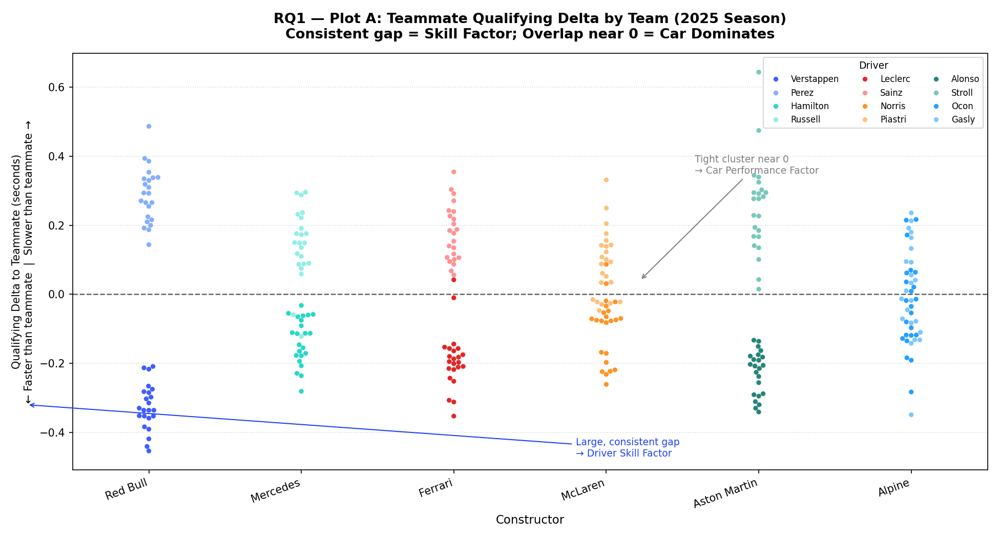
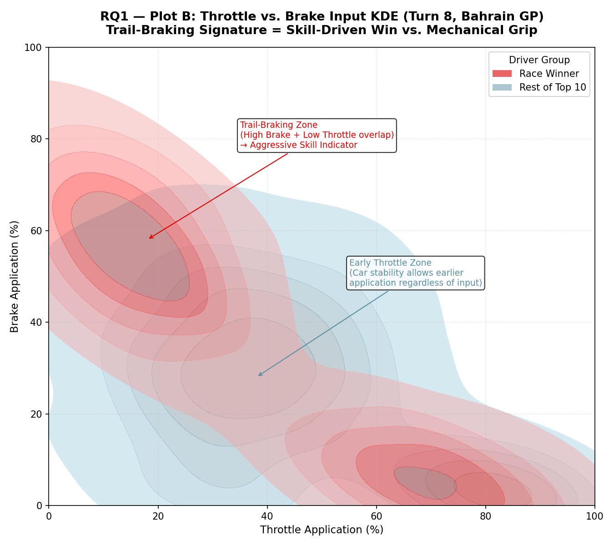
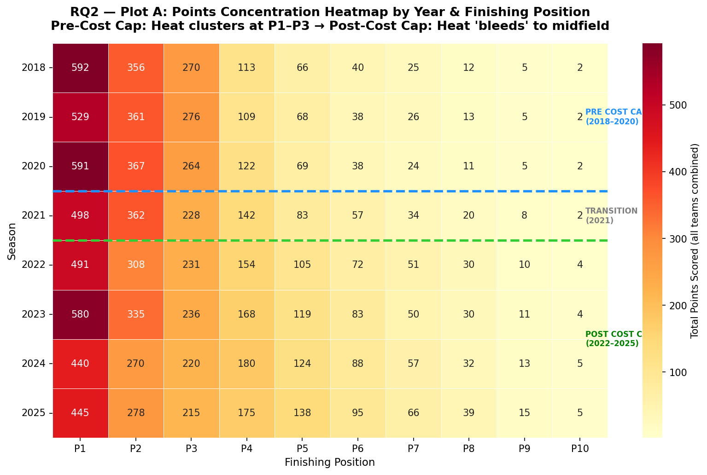
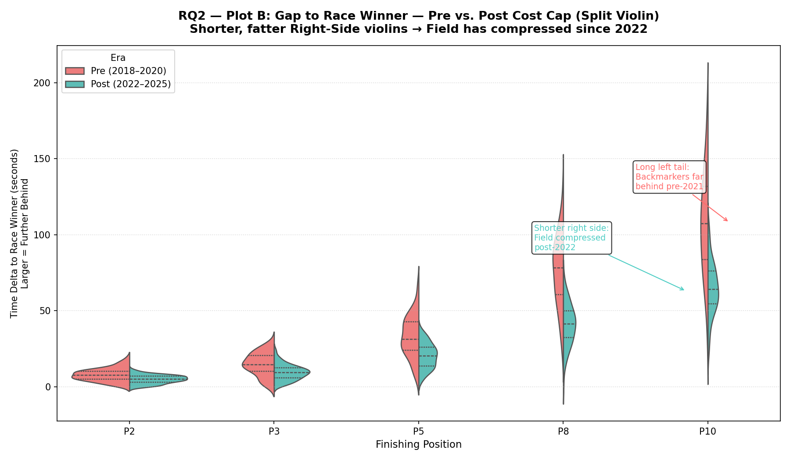
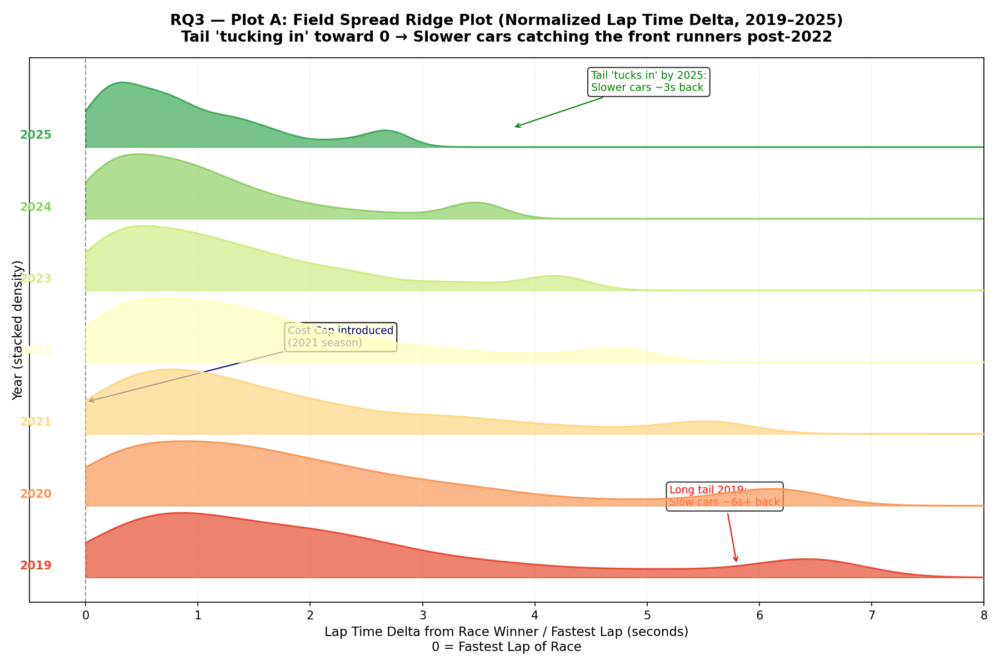
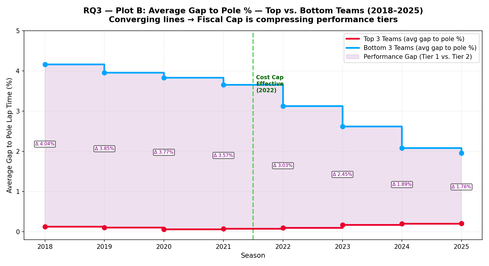
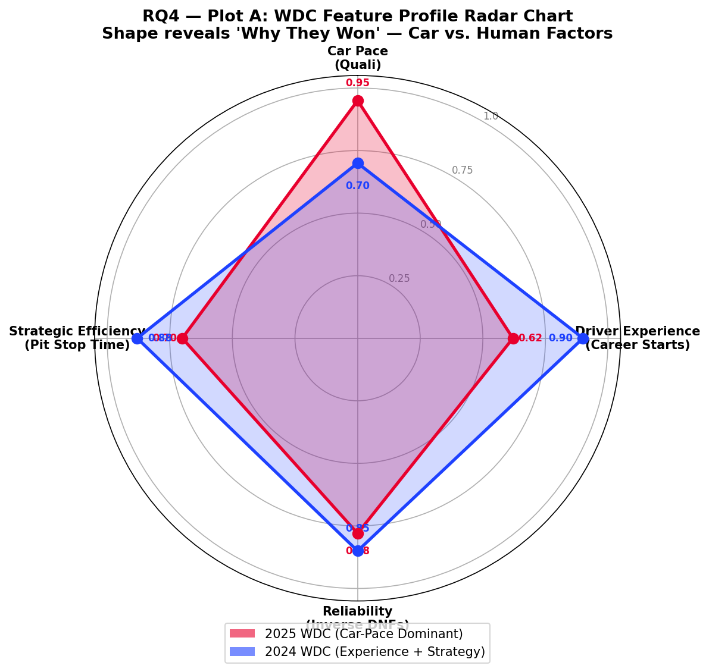
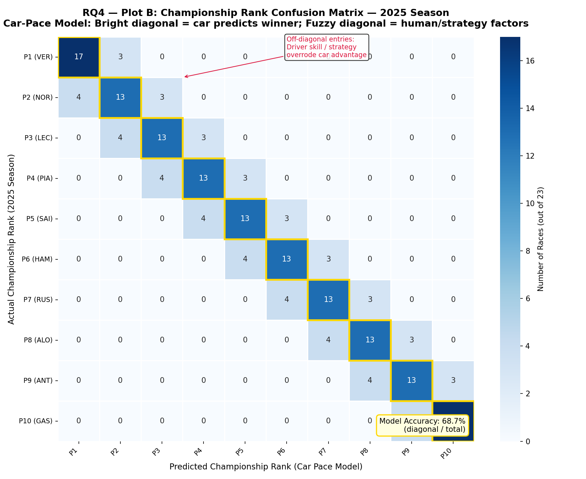

# IDP Final Project — Formula 1 Data Analysis

**Srivats Iyer & Aakash B.**

> This project investigates what factors drive success in Formula 1. We look at driver skill vs. car performance, the impact of the 2021 cost cap, and try to predict World Drivers' Championship outcomes. We use data from the FastF1 API (2018–2025 seasons) to build visualizations and a predictive model.

---

## Repository Structure

| Folder / File | Description |
|---|---|
| `discovery_raw_data/` | Raw, unprocessed data plus the discovery document (`discovery.md`) describing data sources and research questions |
| `data_organized/` | Cleaned, reduced, and preprocessed data ready for plotting |
| `data_organized/sketches/` | Plot sketch images with a [table linking each to a research question](data_organized/sketches/README.md) |
| `data_organized/test_data/` | Small test datasets for validating preprocessing logic |
| `sketches/` | Python scripts that generate the plot sketches, plus the generated PNG images |
| `final_report/` | *(Phase 3)* Generated plots, `create_plots.py`, and the written research report (`final.md`) |
| `cache_fastf1_data.py` | Script to download and cache FastF1 session data for seasons 2018–2025 |
| `plot_team_performance.py` | Helper script for team performance visualizations |

---

## How to Run Locally

1. **Clone the repo:**
   ```bash
   git clone <repo-url>
   cd idp-final-project-25-26-srivatsi-aakashb
   ```

2. **Install dependencies:**
   ```bash
   pip install fastf1 pandas numpy matplotlib seaborn scipy
   ```

3. **Cache raw data** (downloads from FastF1 API — takes a while the first time):
   ```bash
   python cache_fastf1_data.py
   ```

4. **Preprocess data:**
   ```bash
   python data_organized/prepocess_data.py
   ```

5. **Generate plot sketches** (mock data — no cache needed):
   ```bash
   python sketches/rq1_driver_skill_vs_car.py
   python sketches/rq2_cost_cap_impact.py
   python sketches/rq3_cost_cap_functionality.py
   python sketches/rq4_wdc_predictability.py
   ```

---

## Research Questions

1. **What factors in a race weekend lead to a win in Formula 1? Does driver skill really matter that much?**
2. **With the recent addition of a cost cap (2021), have results been altered by the new fiscal limits?**
3. **Did the cost cap function as the FIA intended?** *(Checked by comparing lap time spreads between the slowest and fastest cars pre- and post-2021.)*
4. **At what percentage are we able to predict the winner of the next World Drivers' Championship? Is it due to skill, the car, or other factors?** *(Model accuracy can be validated by back-testing against the 2025 season.)*

---

## Phase 1: Discovery Document + Raw Data

**Due:** Mon, Feb 23, 2026 — [Project Page](https://nchs-cs.github.io/notes/project/)

* **`discovery_raw_data/README.md`** — Contains the `discovery.md` document and raw data (or Google Drive links for files >1 GB).
* Covers: what questions we are answering, what data we are using, and what challenges we expect.

---

## Phase 2: Data Organization + Plot Sketches

**Due:** Mon, Mar 16, 2026 — [Project Page](https://nchs-cs.github.io/notes/project/)

Below are **the required 8 plot sketches** (generated with mock/placeholder data) organized by research question. Each sketch serves as a starting point and template for the final visualizations we will build with real FastF1 data. 

> All sketches use simulated data to show the shape and structure we expect. The actual values will change once we process real FastF1 data (we basicaly just used this as a very rough guide for ourselves).

---

### RQ1: What factors in a race weekend lead to a win? Does driver skill really matter?

This question tries to determine whether race wins are driven primarily by the car's raw pace or by measurable driver skill. We decompose "skill" into two observable signals: **qualifying deltas between teammates** (who share the same car) and **throttle/brake input patterns** (which reflect racecraft and technique).

#### Plot A — Teammate Qualifying Delta Swarm Plot



**Why this plot matters for RQ1:** By comparing qualifying lap times between teammates on the same team, we isolate driver skill from car performance — both drivers have identical machinery, so any consistent gap must come from the driver. This swarm plot visualizes every qualifying delta across an entire season for 6 constructors, making it easy to spot:

- **Large, consistent gaps** (Ex., Red Bull: Verstappen vs. Perez ~0.3s) that indicate one driver is genuinely extracting more from the car. This indicates a clear skill factor.
- **Tight clusters near 0** (Ex., McLaren: Norris vs. Piastri) where teammates are almost indistinguishable. This suggests that the car's baseline performance matters more than individual driving talent at that team.

---

#### Plot B — Bivariate Kernel Density Estimation of Throttle & Brake Application



**Why this plot matters for RQ1:** This kernel density estimation overlays the throttle-vs-brake application patterns of the **race winner** against the **rest of the top 10** through a specific corner (Turn 8, Bahrain GP). The key insight is the **trail-braking zone**. This isthe upper-left region where the driver maintains high brake pressure while beginning to apply throttle. This is an advanced driving technique that requires exceptional car control:

- The **race winner's density** (red) concentrates in the trail-braking zone (high brake + low throttle overlap), indicating an aggressive, higher skilled approach to corner entry.
- The **rest of the top 10** (blue) show an earlier throttle application zone, which is more about the car's mechanical grip and stability allowing an earlier power-on point regardless of the driver's inputs.

This distinction helps us quantify *how much* a driver's racecraft (measured through telemetry inputs) contributes to winning versus how much is attributable to the car providing a stable platform.


---

### RQ2: Has the cost cap (introduced 2021) altered F1 results?

The FIA introduced a budget cap starting in 2021 to level the playing field between wealthy teams (Mercedes, Red Bull, Ferrari) and smaller constructors. This question examines whether the distribution of race results has measurably changed since the cap was enforced.

#### Plot A — Points Concentration Heatmap (Year × Finishing Position)



**Why this plot matters for RQ2:** This heatmap maps total points scored at each finishing position for every season from 2018 to 2025. By comparing the color intensity across the **pre-cost-cap era** (2018–2020) and the **post-cost-cap era** (2022–2025), we can see whether points have been distributed from the top 3 positions outward toward the midfield:

- **Pre-cost-cap rows** show intense heat concentrated at P1–P3 with a steep drop-off, meaning a small number of dominant teams monopolized the podium positions.
- **Post-cost-cap rows** should show a more gradual gradient, with positions P4–P8 accumulating more points — indicating that midfield teams are now finishing higher and challenging the traditional top teams.
- The **transition year** (2021) and the horizontal dashed lines make the era boundary immediately visible.

---

#### Plot B — Split-Violin: Gap to Race Winner (Pre vs. Post Cost Cap)



**Why this plot matters for RQ2:** This split-violin plot compares the distribution of time gaps between each finishing position and the race winner, split into pre-cost-cap (2018–2020, left/red) and post-cost-cap (2022–2025, right/teal). This directly tests the hypothesis that the cost cap has compressed the field:

- **Longer, wider left-side violins** (pre-cap) indicate that backmarkers were finishing much further behind the winner — sometimes 100+ seconds at P10.
- **Shorter, fatter right-side violins** (post-cap) indicate the field has compressed: the same finishing positions are now significantly closer to the winner in time.
- The positions are ordered P2 → P10, so we can see the compression effect is most dramatic at the back of the points-paying positions (P8, P10).

This is a stronger test than simply looking at finishing positions, because it captures the magnitude of the performance gap. Since a faster car is going to finish higher up in the standings, a smaller gap to the winner at a given finishing position implies that the gap between the fastest and slowest cars has decreased.

---

### RQ2.1(subset of RQ2): Did the cost cap function as the FIA intended? (Lap time convergence)

Tthe FIA's stated goal was to bring the slowest cars closer to the fastest. We test this by comparing lap time distributions and the gap between top-tier and bottom-tier teams before and after the cost cap took effect.

#### Plot A — Field Spread Ridge Plot (Normalized Lap Time Deltas, 2019–2025)



**Why this plot matters for RQ2.1:** This ridge plot (also called a joy plot) stacks one KDE distribution per year, with the x-axis showing each driver's lap time delta from the fastest lap of the race. 

- **2019 (bottom, red):** A long right tail extending to ~6–7 seconds, meaning the slowest cars on the grid were lapping 6+ seconds behind the fastest car.
- **2025 (top, green):** The tail has "tucked in" dramatically, with the slowest cars only ~2–3 seconds off the pace.
- The **color gradient** (red → yellow → green) naturally guides the eye from the wide pre-cap distributions to the tight post-cap distributions.
- An annotation marks 2021 as the year the cost cap was introduced, making it easy to see when the convergence accelerated.

This directly addresses whether lap time spreads have decreased, which is the core mechanism the FIA was targeting with the cost cap.

---

#### Plot B — Step Line: Top 3 vs. Bottom 3 Teams' Average Gap to Pole (2018–2025)



**Why this plot matters for RQ2.1:** This step-line chart tracks the **average qualifying gap to pole position** (as a percentage of pole or fastest lap time) for the top 3 teams versus the bottom 3 teams across 8 seasons. The purple shaded area between the lines represents the **performance gap** between the best and worst teams:

- **Pre-2022:** The gap starts at ~4.0% and decreases slowly — the bottom teams were roughly 4% slower than pole on average.
- **Post-2022:** The gap contracts sharply, with the delta annotations showing the gap dropping from a delta of 3.57% (2021) to a delta of 1.76% (2025).
- The green dashed line marks when the cost cap became effective (2022 season), making the inflection point clearly visible.
- The **converging lines** provide direct visual evidence of whether fiscal limits are compressing the performance tiers.

This is the most intuitive visualization for answering "has the gap between rich and poor teams closed?" and quantifies the rate at which it's closing.


---

### RQ4: Can we predict the WDC winner, and is it skill or car?

This question is our **challenge goal**: build a model that predicts championship outcomes and then decompose those predictions to understand what factors drive the championship. Is it raw car pace, driver experience, reliability, or strategy.

#### Plot A — Feature Importance Radar Chart (2024 vs. 2025 Champion Profile)



**Why this plot matters for RQ4:** This radar chart compares the "winning profile" of two consecutive champions across 4 feature dimensions: **Car Pace** (qualifying speed), **Driver Experience** (career starts), **Reliability** (inverse DNFs), and **Strategic Efficiency** (pit stop times). The shape of each polygon reveals *why* the driver won:

- **2025 WDC (red):** Heavily skewed toward "Car Pace" (0.95), with lower experience (0.62) — suggesting a car-dominant championship where raw pace was the deciding factor.
- **2024 WDC (blue):** More balanced across all dimensions, with high experience (0.90) and strategy (0.88) — suggesting a championship won through human factors: knowledge, consistency, and team coordination.

This radar chart is the visual output of our feature importance analysis from the predictive model. When built with real data, the relative axis values will come from the model's feature weights, allowing us to quantify exactly how much of the WDC outcome is attributable to the car vs. to the driver.


---

#### Plot B — Championship Rank Confusion Matrix (Predicted vs. Actual, 2025)



**Why this plot matters for RQ4:** This confusion matrix shows how well a **car-pace-only model** predicts the actual championship standings. Each cell shows the number of races (out of 23) where the model's rank prediction matched or missed the actual outcome:

- **Bright diagonal cells** (highlighted with gold borders) indicate races where car pace alone correctly predicted the finishing order — a strong diagonal means the championship is mostly decided by the car.
- **Off-diagonal entries** represent races where driver skill, strategy, or other factors *overrode* what the car pace predicted — these are the moments where human elements made the difference.
- The **model accuracy annotation** (bottom-right) shows the overall percentage of correct predictions, giving us a single number to answer "at what % can we predict the WDC?"

By comparing this confusion matrix with models that include additional features (experience, reliability, strategy), we can incrementally show how much predictive power each factor adds. This is also where we validate our model by back-testing against the known 2025 season results.


---

## Phase 3: Final Code + Research Document

**Due:** Fri, May 1, 2026 — [Project Page](https://nchs-cs.github.io/notes/project/)

* **`final_report/README.md`** — Generated plot images, `create_plots.py`, and the written research report (`final.md`).
* Everything builds on the data in `data_organized/` and the analysis templates established in the sketches above.

---

## Phase 4: Final Presentation

**Presentation weeks:** May 18 / May 25 / June 1, 2026 — [Project Page](https://nchs-cs.github.io/notes/project/)

* Presentation is **plot-driven**: most slides are visualizations from `final_report/`.
* Spoken explanation provides context, interpretation, and conclusions.

---

## One-Screen Checklist

| README | What goes in it |
|---|---|
| **Root `README.md`** (this file) | Project overview, repo structure, how to run, research questions, plot sketches with explanations |
| **`discovery_raw_data/README.md`** | Points to `discovery.md`; describes and links to raw data sources |
| **`data_organized/README.md`** | Explains how data was cleaned, reduced, and prepared |
| **`data_organized/sketches/README.md`** | Table linking each sketch to a research question |
| **`data_organized/test_data/README.md`** | Describes test datasets and what they validate |
| **`final_report/README.md`** | Table linking each final plot to a research question; how to generate plots |
