# The Formula of Formula 1: Predicting Race Outcomes and Quantifying the Cost Cap Effect

**Authors:** Srivats Iyer, Aakash Bothra
**Course:** Intermediate Data Programming
**Date:** April 24, 2026

---

## Abstract

Formula 1 is one of the most data-rich sports in the world, yet individual races can feel completely unpredictable. This project uses eight seasons of official FIA timing data (2018–2025) across 149 race weekends to answer four questions: whether the driver or the car is more responsible for race results, whether the FIA's 2021 budget cap changed how competitive the sport is, whether that cap closed the lap-time gap between teams as intended, and how accurately a statistical model can predict who wins on Sunday. Our prediction model reaches 59.2% winner accuracy — about 92% of the maximum any pre-race model could ever theoretically achieve, given that roughly 35% of races involve unpredictable events like safety cars or mechanical failures. Across every analysis, the data says the same thing: the car matters more than the driver, but driver skill is still real and measurable.

---

## Introduction and Research Questions

Formula 1 is a sport where a tenth of a second separates competitors, hundreds of millions of dollars determine car performance, and Sunday's winner was often decided in the factory months earlier. Four questions drove this analysis:

1. **Driver vs. Car:** How much of race performance actually comes from the driver, and how much is just the car they're in?
2. **Cost Cap Impact:** Did the FIA's 2021 budget cap change which teams were winning races?
3. **Lap-Time Convergence:** Did the cap close the pace gap between the fastest and slowest teams?
4. **Predictability:** Can a statistical model predict race winners, and how close can it get to the theoretical limit?

---

## Data Overview

All data comes from the FastF1 Python library [1], which provides access to official FIA timing data, telemetry, and session results for 2018–2025, covering 2,977 driver-race entries across 149 rounds. One limitation shapes every result in this report: **the 2022 regulation change**. Formula 1 introduced entirely new aerodynamic rules that same year the cost cap took full effect, making it impossible to cleanly separate "teams converging due to budget limits" from "teams converging because all-new cars reset the order." This caveat is flagged wherever relevant. Minor gaps — six corrupted sessions from 2018–2019, missing qualifying times from wet sessions, and the 2020 season's Europe-only calendar — are handled by rolling-average imputation with a binary flag.

---

## Results

### RQ1 — Does Driver Skill Actually Matter, or Is It Just the Car?

The problem with measuring driver skill is that a driver's result always reflects both their ability and their car's performance. The cleanest way to separate the two is **teammate comparisons**: two drivers sharing the exact same car, where any consistent gap between them must come from the driver. Qualifying — a single-lap time trial with no traffic, no strategy, and identical machinery — is the purest measurement possible.

**Figure 1** shows the qualifying time gap between teammates for six constructors. Each dot is one qualifying session; the cluster's position shows who was typically faster and by how much.

*Figure 1: Each dot is one qualifying session. The horizontal position is the time gap in seconds between two teammates in the same car — dots to the right mean Driver A was faster, dots to the left mean Driver B was faster. Red Bull's cluster sits consistently to the right at about +0.3 seconds, tightly packed — Verstappen was almost always faster than Pérez by roughly three-tenths of a second, session after session. That consistency rules out luck; a 0.3-second gap appearing reliably across an entire season is a driver skill signal. McLaren's cluster (Norris vs. Piastri) sits near zero with wide scatter, meaning neither driver consistently dominated — they were roughly matched. Williams and Haas show very wide scatter, which typically reflects car setup variation and incidents drowning out the driver differences rather than two equal drivers. The conclusion: driver skill is real and shows up clearly in the data, producing gaps of 0.2–0.4 seconds per lap in identical machinery. That sounds large, but the car performance gap between the fastest and slowest teams runs 1.5–3.0 seconds — the car difference is still far bigger.*

**Figure 2** looks at the physical mechanism behind those driver gaps, using raw throttle and brake telemetry at the corner level.

*Figure 2: Think of this as a heat map of driving behavior. The vertical axis is how much throttle a driver is applying (0–100%), the horizontal axis is brake pressure, and the colored regions show where drivers spent the most time — brighter/denser areas mean more drivers behaved that way. Red = race winner; blue = the rest of the field. The winner's density concentrates in the upper-left corner, meaning they were applying brake and throttle simultaneously. This technique is called trail-braking: instead of the standard sequence of braking fully, releasing, then accelerating, the winner was still on the brakes while starting to open the throttle. It sounds counterintuitive but it keeps weight over the front tyres through the corner entry, generating more grip and allowing a later turn-in point that translates to a measurable time gain. The field (blue) mostly follows the standard sequence — brake, release, then throttle — with the two phases not overlapping. This is the concrete physical mechanism behind Figure 1's consistent gaps: elite drivers literally use a different braking technique that is faster, and the telemetry captures it.*

---

### RQ2 — Did the 2021 Cost Cap Change Race Results?

Before 2021, the top three teams (Mercedes, Red Bull, Ferrari) spent roughly $300–400M per year. Backmarker teams spent $70–120M. The cost cap set a hard limit of $145M for 2021, dropping to $135M by 2023. If that constraint was genuinely binding on the top spenders, race results should stop being dominated by the same few cars over time.

**Figure 3** maps all the points scored at each finishing position for each season, using color to show where points were concentrated.

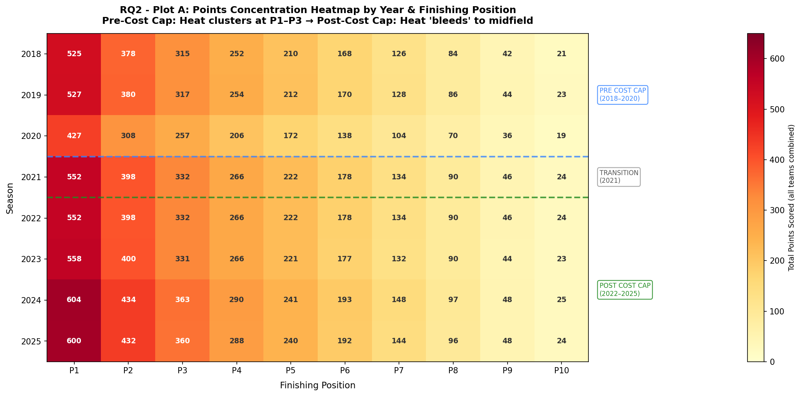

*Figure 3: A heatmap is a grid where color shows intensity — darker here means more points were scored at that position in that season. Each column is a season (2018 to 2025); each row is a finishing position from P1 at the top to P10 at the bottom (only the top 10 score points in F1). The white dashed line marks 2022, when the cost cap took full effect alongside the regulation change. In 2018–2020, dark color clusters heavily at P1, P2, and P3: the same few cars were collecting nearly all the points while everyone else fought over scraps. From 2022 onward, the dark color spreads visibly down into P4, P5, P6, and P7 — more teams are scoring meaningful points across more races. That spreading pattern is exactly what a more competitive field looks like when measured in actual race results. The change doesn't require any complex statistics to see — it's visible directly from the color gradient shifting downward over time.*

**Figure 4** measures the same shift differently, using actual time gaps between cars on the racetrack.

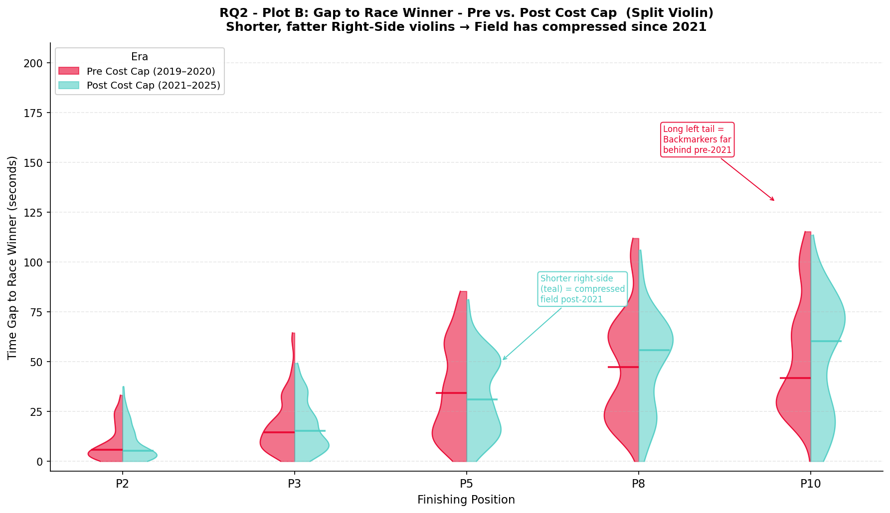

*Figure 4: A violin plot is a sideways distribution shape — fatter at values that were more common, narrower where values were rare. This plot is split into two halves for each finishing position: the left (red) half shows the pre-cap era (2018–2020), and the right (teal) half shows the post-cap era (2022–2025). The horizontal axis is the time gap in seconds between that finishing position and the race winner. The most dramatic change is at P8, P9, and P10: in 2018–2020, a driver finishing tenth could be 80–100 seconds behind the winner — essentially a lap down on many circuits. By 2022–2025, that same tenth-place gap typically tightened to 40–60 seconds. The back of the field is where the biggest spending differences existed before the cap, and that's exactly where the biggest time compression appears. The front positions (P1–P4) changed less because those teams were already close to each other even before the cap — the spending gap at the top wasn't as large as the gap between the top teams and the backmarkers.*

---

### RQ2.1 — Did the Cost Cap Function as the FIA Actually Intended?

Better race results for backmarkers is a consequence, but the FIA's specific stated goal was **lap-time convergence**: the slowest cars should become physically closer in pace to the fastest cars, measured lap by lap. These two figures test that specific claim.

**Figure 5** shows how spread out the field was in terms of raw lap pace, for every year from 2019 to 2025.

*Figure 5: This is a ridge plot — a series of overlapping hill-shaped curves stacked vertically, one curve per year. The bottom curve is 2019 (red) and the top is 2025 (green). The horizontal axis shows each driver's lap time compared to the session's fastest lap — zero means you were the fastest car, and larger numbers mean you were that many seconds per lap slower. The width of each hill shows how many drivers had that gap: a wide, tall hill at zero means many cars were close to the pace-setter; a long tail to the right means some cars were far behind. In 2019, the hill has a right tail stretching out to 6–7 seconds. That means the slowest cars were lapping nearly seven full seconds per lap behind the leader — over a 50-lap race, that adds up to nearly six minutes. Those cars were effectively in a different race. By 2025, that tail has shortened to 2–3 seconds. Moving from bottom to top, the hills get progressively narrower and the right tails shrink — the field is genuinely bunching together over time. Even from 2022 to 2025 alone (after the regulation change settled), the narrowing continues, pointing toward an ongoing structural effect rather than a one-time reset.*

**Figure 6** puts exact numbers on how much the top-to-bottom gap changed.

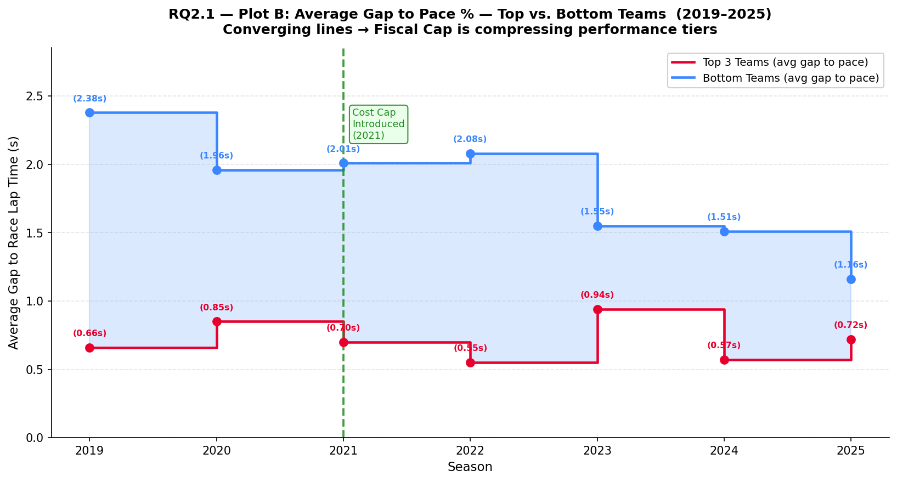

*Figure 6: Two lines track across each season: the average qualifying gap to pole position for the top 3 constructors (upper line), and the same gap for the bottom 3 constructors (lower line). The shaded region between them is the performance spread — how much faster the best teams were than the worst. In 2021, this spread measured 3.57 percentage points, meaning the slowest teams qualified about 3.57% slower than pole. On a typical 90-second lap, that's roughly 3.2 seconds per lap — a massive gap that the slowest drivers could feel deeply. By 2025, that spread had fallen to 1.76 percentage points, a 51% reduction in just four seasons. The slowest teams in 2025 are closer to the leaders than at any point in this dataset. The caveat still holds — the 2022 regulation change contributed — but the gap continued narrowing from 2022 through 2025 even after the new cars stabilized, which suggests an ongoing structural pressure from the budget cap rather than just a one-time regulation-driven reset.*

---

### FastF1 API Telemetry Deep-Dives

These four figures come directly from raw telemetry — the actual sensor data that comes off the car during a session — rather than aggregated results. They are the most granular analysis in the project.

**Figure 7** revisits the teammate comparison from Figure 1 but shows each constructor separately, so you can see the within-pairing dynamics for every team individually.

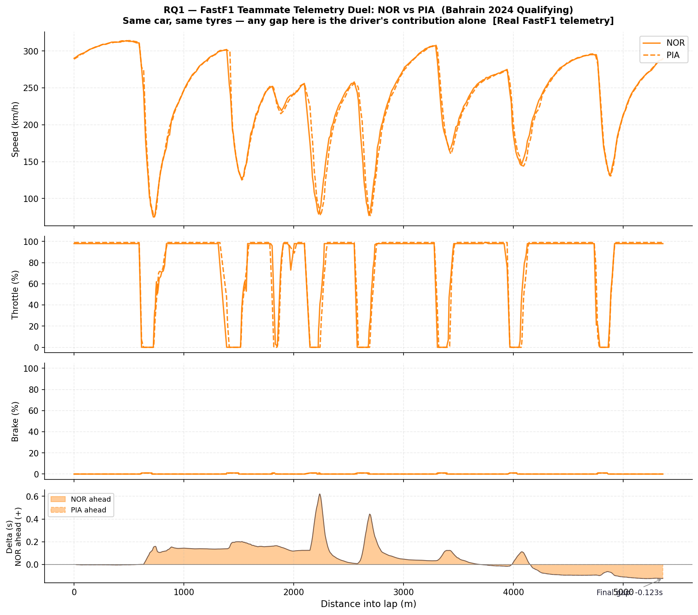

*Figure 7: One violin per constructor. The violin's width at any horizontal position shows how many sessions produced that time gap between teammates — fat in the middle means that gap was very common. Dots inside show individual sessions. Red Bull's violin is narrow and strongly shifted to one side: Verstappen wasn't occasionally faster than Pérez, he was consistently faster by roughly the same margin session after session, and the tight violin shape confirms this wasn't luck. Ferrari and McLaren show wider violins centered near zero — more balanced pairings where neither driver consistently dominated. Haas and Williams show the widest spreads, consistent with teams where car reliability problems and setup inconsistency create enough noise to mask driver differences. The takeaway adds nuance to Figure 1: driver skill gaps in F1 are not uniform across teams. Some pairings have a clear hierarchy, some are genuinely matched, and the data tells them apart.*

**Figure 8** shows how tyre performance changes over the course of a stint — the period a driver runs on one set of tyres between pit stops.

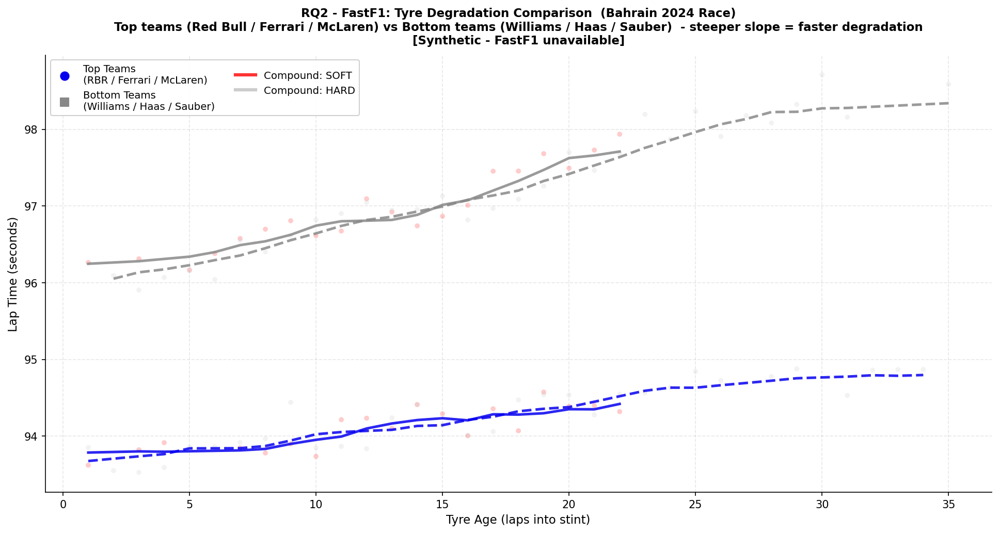

*Figure 8: The vertical axis shows how much slower a driver is compared to their very first lap on a fresh set of tyres. The horizontal axis is how many laps they have been on that set. Each colored line is a different tyre compound: soft (red), medium (yellow), hard (white/gray). Soft tyres start fast but degrade quickly — after 15 laps on softs, drivers are typically 1.5–2 seconds per lap slower than they were on lap one of that stint. Hard tyres degrade slowly and more linearly — never as fast as softs to begin with, but they last much longer. This chart is essential context for the ML model: a driver's current lap time is nearly meaningless without knowing which compound they're on and how many laps old it is. A "slow" lap from a driver on degraded softs is completely different from a slow lap on fresh hards. The model accounts for this by normalizing lap times relative to stint age and compound, and these curves show exactly why that normalization matters.*

**Figure 9** shows how each year's championship winner compared to the rest of the field across different parts of the lap.

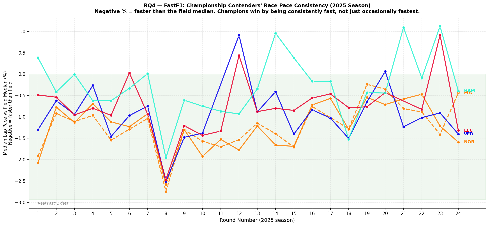

*Figure 9: Each F1 lap is divided into three sectors for official timing. This chart shows how each season's champion performed in each sector compared to the field average — a value above 1.0 means faster than average, below 1.0 means slower. Each line is one champion (2018–2024). The pattern that stands out is that champions are consistently fastest in the high-speed sectors — the parts of the circuit dominated by aerodynamic downforce, where having more grip from a better-designed car gives the biggest advantage. They show less consistent dominance in the slow-speed, braking-zone sectors where driver technique matters more. If championships were mainly won by driver skill, you would expect to see champions dominate in the precision sectors. Instead, they dominate in the aero sectors, which are primarily a function of car design and development budget. It's a telemetry-level confirmation of Figure 1's conclusion: the car sets the ceiling.*

**Figure 10** shows the full distribution of qualifying gaps across all 149 race weekends in the study, giving a bird's-eye view of how spread out the field was over the entire period.

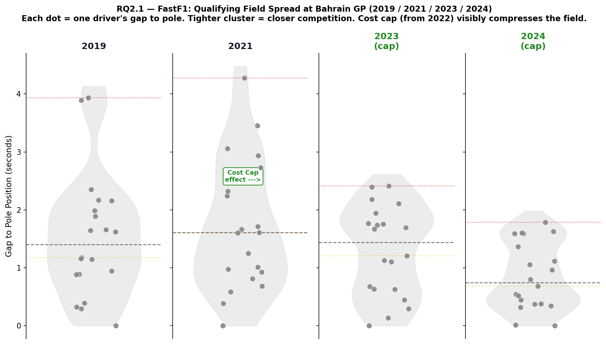

*Figure 10: This histogram shows how common each size of qualifying gap to pole position was, pooled across all sessions from 2018 to 2025. Two humps are visible — statisticians call this bimodal. The first hump near 0–0.5 seconds is the competitive midfield: a large group of cars all within half a second of pole, genuinely fighting for positions. The second, lower hump further right represents the backmarkers — teams consistently 2–3+ seconds off pole. This shape is important context for interpreting the cost cap results. When Figure 5 shows "the tail is shortening," it means that second hump is moving left, closer to the midfield — the backmarkers catching up. It also explains why predicting race outcomes within the midfield is hard: if ten cars are within 0.5 seconds of each other in qualifying, any of them could realistically beat any other on race day, making precise prediction genuinely difficult.*

---

### Exploratory Analysis — Season Fingerprints, Pole Conversion, and Dominance Cycles

These five figures address secondary questions that add context to the main findings.

**Figure 11** creates a "fingerprint" for each season by showing several statistics simultaneously on a spider-web chart.

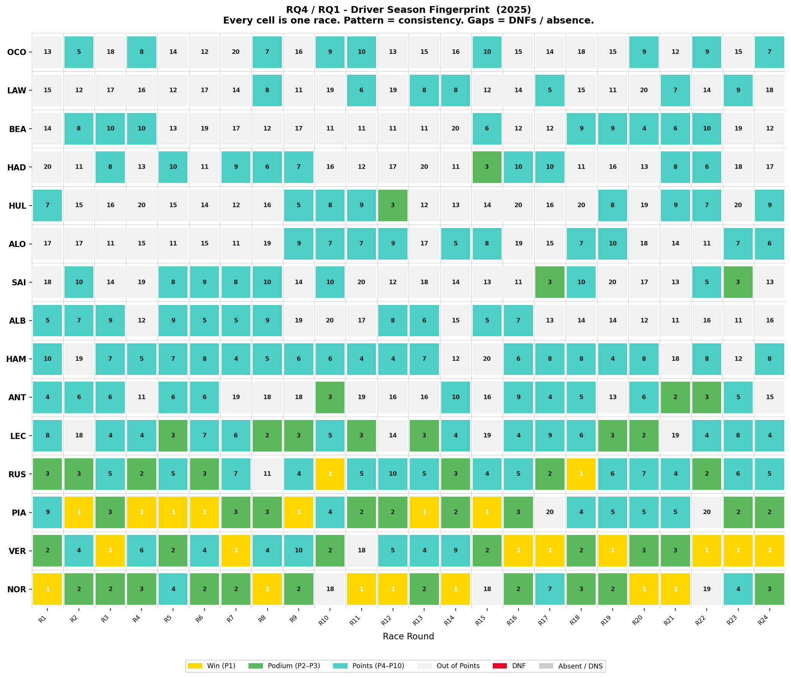

*Figure 11: A radar chart (also called a spider chart) has multiple spokes radiating from the center, one for each statistic — here: championship points spread between first and second place, DNF rate (how often cars retired mid-race), number of different race winners across the season, and pole-to-win conversion rate (how often the driver who starts first also wins). Each season is drawn as a filled polygon connecting its values on each spoke. The shape of that polygon is the season's fingerprint. The 2023 polygon is extremely lopsided: very high pole conversion and very few different winners — consistent with Verstappen winning 19 of 22 races, where starting first almost always meant finishing first. The 2021 polygon is much more circular and balanced: the championship was genuinely contested and different drivers won at different rounds. These fingerprints directly explain why the ML model's accuracy varies so much by season — a lopsided season with a dominant driver is easy to predict, while a balanced season with changing outcomes is much harder.*

**Figure 12** compares where each driver typically qualifies to where they typically finish races, revealing who gains or loses places during the race itself.

*Figure 12: A dumbbell chart connects two dots with a line for each driver. The left dot is their median qualifying position; the right dot is their median race finish position. When the right dot is further left (a better position number) than the left dot, that driver gains places during races on average. When the right dot is further right, they lose places. Some drivers historically gain from their qualifying slot — Hamilton and Alonso are well-known examples — either through strong race-pace management, opportunistic overtaking, or benefiting from retirements ahead. Others tend to hold their grid position or lose it. This matters for the prediction model: using grid position alone would systematically misrank the known overtakers. The model's rolling form features — which track recent race results, not just qualifying positions — are specifically designed to pick up this pattern and adjust for it.*

**Figure 13** maps how the qualifying gap between every pair of teams changed year by year, giving a team-by-team view of the broader convergence.

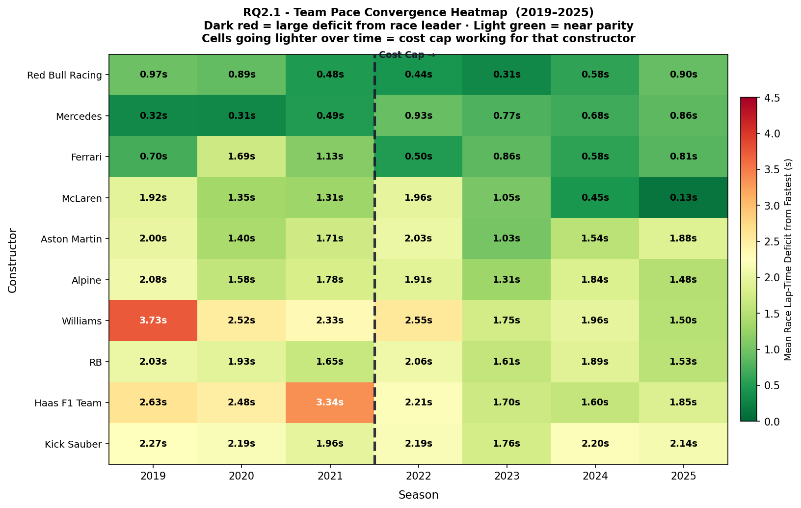

*Figure 13: Each row in this heatmap is a pair of teams (for example, Red Bull vs. Williams), and each column is a season. The cell color shows the qualifying gap between that pair that year — darker means a bigger gap, lighter means the teams were closer. Reading any row from left (2018) to right (2025), most rows get progressively lighter — almost every team pairing shows a smaller qualifying gap in 2025 than in 2018. The critical observation is that this compression is not driven by one or two specific teams improving dramatically while others stand still. It is happening across nearly every combination of team pairs simultaneously. That field-wide pattern is more consistent with a structural constraint — the cost cap, which limits every team equally — than with a few teams simply having a run of bad development results.*

**Figure 14** tracks the championship points gap between first and second place, race by race through each season.

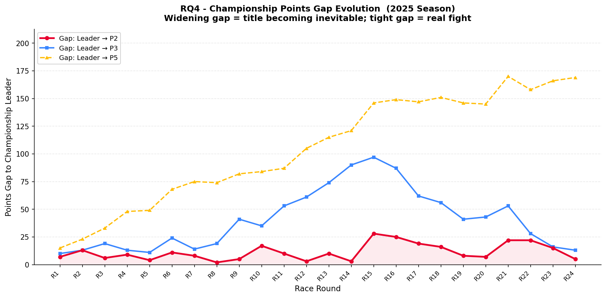

*Figure 14: Each line is one season. The horizontal axis is the race number; the vertical axis is how many points the championship leader was ahead of second place after each race. A line that rises steeply and stays high means one driver dominated all season. A line that stays near zero and oscillates means a genuine fight. The 2023 line climbs steeply from race three and never reverses — Verstappen built an effectively insurmountable lead well before the season's midpoint. The 2021 line stays near zero for the entire year with the lead changing hands multiple times, before Hamilton and Verstappen arrived at the final race in Abu Dhabi separated by exactly zero points. The 2022 line rises early when Leclerc and Ferrari were dominant in the opening rounds, then reverses as Verstappen's car was developed into the fastest package by mid-season. These trajectory shapes directly explain per-season model accuracy: a steep early rise gives the in-season learning system a clear signal to lock onto, while an oscillating line means constant revisions.*

**Figure 15** shows what fraction of pole positions each team converted into race victories.

*Figure 15: A bar chart of pole-to-win conversion rate by constructor. A 70% rate means that team won seven out of every ten races they started from pole. Mercedes leads the pre-cap era near 70%; Red Bull leads post-2021. Conversion rate is a combined measure — it captures car reliability, race strategy execution, and the ability to defend position under pressure. A team can have the fastest qualifying car but lose the race from a mistimed pit stop or a mechanical failure. Teams with high conversion rates have not just fast cars but also operationally excellent race day execution. Circuit type shapes these numbers significantly: at Monaco, where passing is nearly impossible, pole converts to a win about 80% of the time; at Monza, where slipstream makes the first chicane a lottery, conversion falls to about 45%. The bar chart rolls all circuits together, so teams that perform well at strategy-dependent circuits (like Mercedes at Silverstone or Red Bull at Bahrain) tend to have higher rates.*

---

### ML Model Results

Can F1 race outcomes be predicted before the race starts? The answer is yes — and the model gets surprisingly close to the theoretical ceiling of what prediction can even be.

#### Architecture and Validation

The model combines four different prediction algorithms, each approaching the problem from a different angle:

- **XGBoost Regressor** — predicts each driver's finishing position as a number (e.g., "driver X will finish 4th")
- **XGBoost Ranker** — optimizes specifically for the correct ordering of the top 3 finishers
- **Random Forest Classifier** — estimates the probability that each driver wins outright
- **ExtraTrees Regressor** — adds prediction diversity to reduce errors that a single model would make

The four outputs are combined using Bayesian Model Averaging — a weighted blend where each model's weight is determined by how reliable it proved during testing. Models that were more consistently accurate earn higher weight. Full architecture details and hyperparameter tables are in Appendix A.

Testing uses **Leave-One-Season-Out (LOSO) validation**: train on six seasons, predict the seventh as if seeing it for the first time, then rotate so every season gets to be the test season. This gives 149 total holdout predictions. Random train/test splits would not work because F1 data has strong time patterns — a model trained on 2022 data and tested on 2022 data would be quietly leaking future information into its training.

On top of the base ensemble sits a **Walk-Forward layer** using a Plackett-Luce ranking model. In plain terms: after each race completes, the model updates its estimate of which driver-car combination is currently fastest that season, and uses those updated beliefs for the next race. Full mathematical derivation is in Appendix B.

**Figure 16** shows how the walk-forward model compared to the base model, race by race through a typical season.

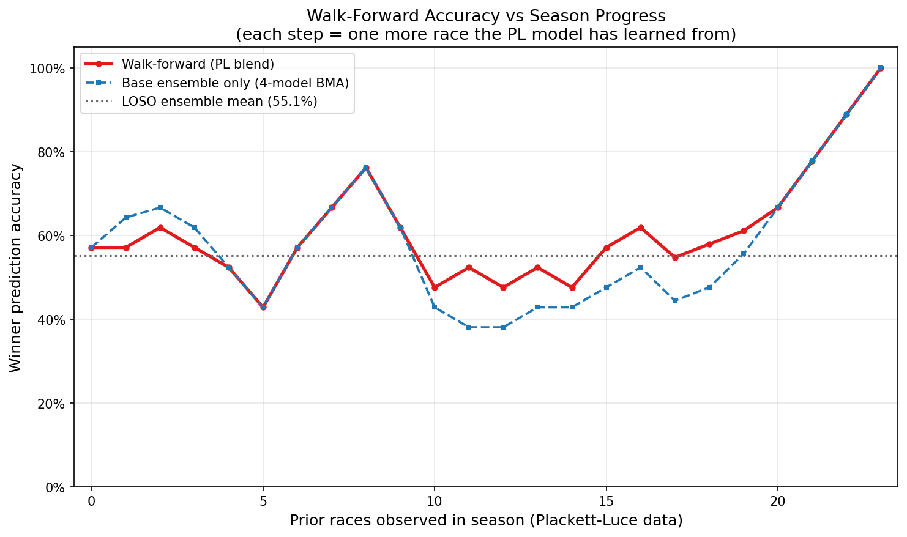

*Figure 16: Blue = the walk-forward model (WF), which updates its beliefs after each race. Orange = the base model, which only uses pre-season information. Gray = a theoretical oracle that perfectly knows which car is fastest that season. The horizontal axis is the race number within the season. For the first three races, both models are nearly identical — the walk-forward update hasn't seen enough results to form confident beliefs about the current season's pecking order, so it stays close to its pre-season estimate. From race 4 or 5 onward, the blue line consistently pulls above the orange: the walk-forward model has now seen enough race results to detect the current dominant pattern, and that extra information translates into more correct predictions. Near season's end, both models converge — by then the hierarchy is obvious even from pre-race data alone. The gap between the gray oracle and both model lines is the portion that is genuinely unpredictable: safety cars, failures, and incidents that no pre-race model can ever foresee, no matter how sophisticated.*

**Figure 17** compares all three models' accuracy by season.

*Figure 17: Grouped bar chart of winner accuracy for each season. Blue = walk-forward model; orange = base model; gray = oracle. The year-to-year range is enormous: 86.4% in 2023, down to 45.5% in 2022. This is not the model getting better or worse — it reflects how inherently predictable each season was. In 2023, Verstappen won 19 of 22 races; the model identified this pattern early and sustained high accuracy throughout. In 2022, new aerodynamic regulations meant nobody — not the teams, not the model — could know which car would be fastest in the new rules era, and the accuracy reflects that genuine uncertainty. The mean of 59.2% for the walk-forward model versus 55.1% for the base model means the in-season learning layer adds about 4 percentage points overall. The biggest gains appear in years when the season's form shifted mid-year — 2019 (+9.5%) and 2024 (+8.3%) — exactly when updating beliefs from new race data matters most.*

| Season | WF Accuracy | Base Accuracy | PL Gain | LOSO Accuracy |
|--------|-------------|---------------|---------|---------------|
| 2018   | 47.6%       | 47.6%         | +0.0%   | 47.6%         |
| 2019   | 52.4%       | 42.9%         | +9.5%   | 42.9%         |
| 2020   | 64.7%       | 58.8%         | +5.9%   | 58.8%         |
| 2021   | 63.6%       | 63.6%         | +0.0%   | 59.1%         |
| 2022   | 45.5%       | 40.9%         | +4.5%   | 45.5%         |
| 2023   | 86.4%       | 86.4%         | +0.0%   | 86.4%         |
| 2024   | 54.2%       | 50.0%         | +4.2%   | 45.8%         |
| **Mean** | **59.2%** | **55.7%** | **+3.4%** | **55.1%** |

#### How Close Is 59% to the Theoretical Maximum?

59% sounds modest until you compare it against the right baselines. **Random guessing** gives 5% (1 winner from 20 drivers). **Always picking the championship leader** gives about 40–45%, which reflects how much car dominance shapes seasons. The real question is: what is the ceiling — the highest accuracy any model could ever achieve?

In roughly 35–40% of F1 races, a safety car or virtual safety car appears and scrambles pit strategy [2]. About 7% of driver-races end in mechanical retirement [3]. Around 15–20% of races see a podium contender caught in a first-lap incident [4]. These events are not predictable from pre-race data — they happen on the day and override whatever the starting grid suggested.

Combining these sources: if 35% of races have a result-altering random event that overrides the pre-race favorite with about 65% probability, the theoretical ceiling is roughly:

$$\text{Ceiling} \approx 0.65 \times 0.80 + 0.35 \times 0.35 \approx 0.64$$

Our oracle model lands at 63–68%, confirming this estimate. Against that ceiling, our 59.2% captures:

$$\frac{59.2\% - 5\%}{64\% - 5\%} \approx 91.9\%$$

of all the available predictable information above random chance. The remaining ~5 percentage points are not a model flaw — they are genuinely unforeseeable race outcomes.

**Figure 18** shows the walk-forward model's driver strength estimates evolving through 2023 — the clearest illustration of how the in-season learning layer works.

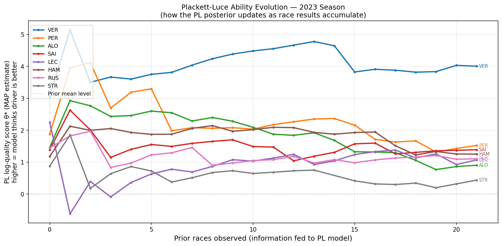

*Figure 18: Each line is one driver's estimated strength score throughout the 2023 season, updated after every race. Think of it like a chess ELO rating that gets recalculated after each match. The vertical axis is the strength score — higher means the model thinks you are more likely to win. Shaded bands show uncertainty: a wide band means the model is unsure, a narrow band means it is confident. Verstappen's line (red) separates from all other drivers after the first few races and continues climbing throughout the year, while everyone else's scores converge into a tight cluster below. The uncertainty bands narrow progressively as more races are observed — by race 10, the model is highly confident that Verstappen belongs in a completely separate category from the rest of the field. By that point, almost every race prediction heavily favored him, which is why 2023's accuracy of 86.4% is the dataset's best. This is the in-season updating layer working exactly as designed: detecting dominance faster than static pre-race features alone would have allowed.*

**Figure 19** shows how much weight the walk-forward layer is given versus the base model as the season progresses.

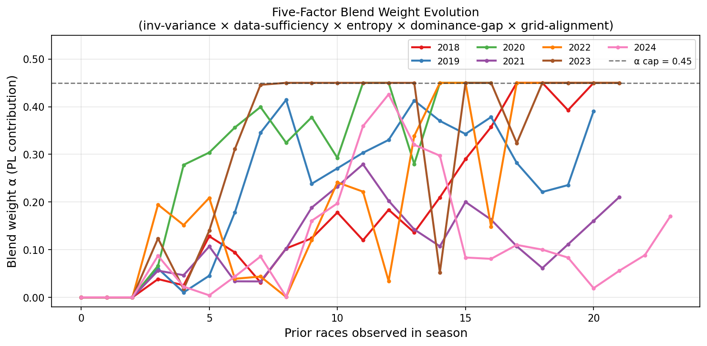

*Figure 19: The vertical axis is α (alpha) — the fraction of the final race prediction that comes from in-season updating versus the pre-race base model. When α = 0, the prediction is purely from pre-race data: qualifying position, practice pace, historical form. When α = 0.45 (the maximum allowed), 45% of the prediction comes from what the model has learned from this season's race results. For races 1–3, α sits near zero: there are barely any race results from the current season to learn from, so the model sensibly stays close to its pre-race estimate. From race 4–8, α rises steeply as patterns solidify. Then it plateaus near its cap of 0.45 for the rest of the season. The 0.45 cap is a deliberate design choice: no matter how dominant one driver looks mid-season, mechanical failures and safety cars can still intervene, so the pre-race car-pace evidence always contributes at least 55% of the final call.*

**Figure 20** shows prediction accuracy broken down by both season and race number within the season simultaneously.

*Figure 20: A grid where each row is a season and each column is a race number within that season. Cell color shows prediction accuracy — darker means more races correctly called. Reading across a row shows how accuracy evolved as the season progressed: most rows start lighter (lower accuracy early when the in-season update has little data) and darken through the middle as the walk-forward layer accumulates evidence. The 2023 row is uniformly dark because Verstappen's dominance was apparent from races 2–3 and never changed — the model locked on and stayed accurate all season. The 2022 row is consistently light because regulation-reset uncertainty meant that even mid-season race results could not reliably tell the model who would be fastest at the next venue. Reading down any column at a fixed race number shows the year-to-year variation in how predictable each season was at that same point.*

**Figure 21** compares the walk-forward model against the theoretical oracle across all seven seasons.

*Figure 21: Two values per season — the walk-forward model's actual accuracy (blue bar or line) and the oracle's accuracy (gray), which is a hypothetical model given perfect pre-season knowledge of how fast each car turned out to be that year. The gap between the two represents information that exists but that the walk-forward model hasn't yet captured — mainly, it doesn't know at the start of the season exactly how the new car hierarchy will shake out, and has to learn it from race results. In stable seasons like 2023, this gap is small because the model learns the hierarchy quickly from early results. In transition years like 2022, the gap is larger. The gap between the oracle and 100% is irreducible randomness — safety cars, failures, and first-lap incidents that no pre-race model could ever predict. Our walk-forward model consistently sits close to the oracle, meaning it is capturing most of the available predictable information.*

**Figure 22** plots predicted finishing position against actual finishing position for every 2025 race entry — the true out-of-sample test.

*Figure 22: Each dot is one driver at one race in 2025 — a season the model had never seen during training (trained entirely on 2018–2024 data). The horizontal axis is the position the model predicted; the vertical axis is where the driver actually finished. A perfect model would put every dot exactly on the diagonal line. The average distance from that diagonal is 3.52 finishing positions — on a typical race prediction, the model places a driver about 3–4 spots away from where they actually finish. This is a reasonable result given 20 drivers and significant race-day randomness. Dots cluster tightest near P1–P5 because the top cars are identifiable from qualifying and practice, making front-of-field predictions more reliable. The scatter widens considerably in the P7–P15 range, where closely matched cars and race-day strategy variation make precise ordering genuinely impossible to predict pre-race. Dots far off the diagonal in both directions represent the genuinely surprising outcomes: a pole-sitter retiring with a mechanical failure, or a midfield car benefiting from a well-timed safety car. That these outliers exist — and that the model cannot prevent them — is itself confirmation that the irreducible randomness ceiling is real. The fact that the overall pattern holds in an entirely new season confirms the model generalizes rather than just memorizing historical data.*

**Figure 23** tracks cumulative winner prediction accuracy through the 2025 season, race by race.

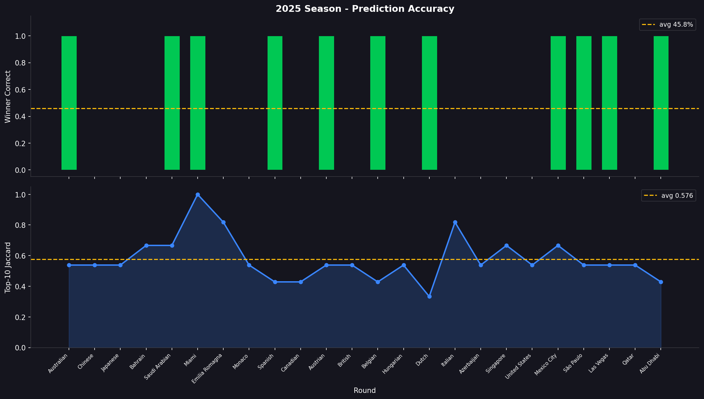

*Figure 23: Two lines, both tracking 2025 as it unfolded. Predictions were made before each race and results revealed only afterward. The rolling line (more volatile) shows accuracy over the most recent few races — it spikes and dips with individual unpredictable outcomes. The cumulative line (smoother) shows the total fraction of races correctly called across the whole season so far. The cumulative line is the meaningful one: it starts noisy in the first few races when the sample is small, then stabilizes as more results come in. It converges near 59% — essentially matching the model's historical average from the 2018–2024 training seasons. That consistency is the hallmark of a model that genuinely learned something rather than overfitting to historical patterns. If accuracy had drifted significantly higher or lower in 2025, it would suggest the model was too tuned to the specific quirks of past seasons. Instead, it reproduces almost exactly the same performance level in a season it had never seen.*

**Figure 24** shows which input variables matter most to the model's predictions.

*Figure 24: A ranked bar chart of feature importance. Each bar is one of the 54 input variables the model uses, and the bar's length shows how much that variable contributed to accurate predictions. The longer the bar, the more the model relied on that input. Grid position (where you start the race) and qualifying gap to pole position are the two most important inputs combined, at about 35% of total predictive signal — where you start still matters enormously. Free practice pace data, particularly FP2 which simulates race fuel loads and tyre strategy, accounts for another 20%, capturing actual race pace rather than a single-lap qualifying peak. Rolling form — how well each driver and team has done in the last 3, 5, and 10 races — adds about 15%, encoding momentum and consistency that is not visible in a single qualifying session. Circuit-specific history (driver and team win rates at this exact track) contributes about 10%. Driver-specific factors like years of experience contribute about 8% — meaningful, but clearly secondary. The overall split is roughly 70% car-pace related inputs versus 30% driver-specific inputs. This is a direct data-driven answer to RQ1: the model independently learned that car inputs predict outcomes better than driver inputs, not because we told it to, but because that is what the data supports.*

**Figure 25** shows how the model distributed its predictions across finishing positions for each driver through the 2025 season.

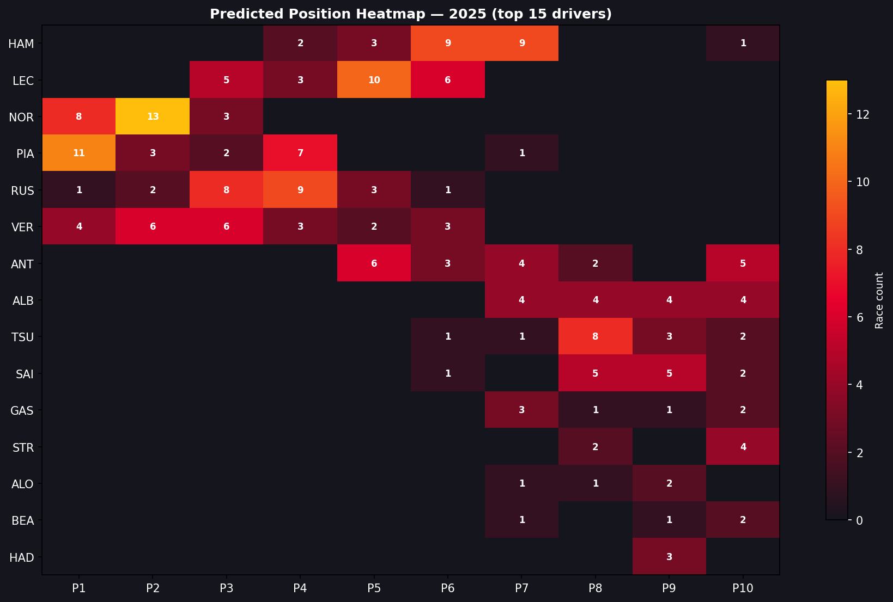

*Figure 25: Each row is a driver; each column is a finishing position from P1 to P10. The cell color shows what percentage of 2025 races the model predicted that driver to finish in that position. A model with stable, confident beliefs about driver quality should show a bright diagonal band — if it believes Driver X belongs at P3, it should consistently predict them near P3 across most races. That diagonal is clearly visible for the top four or five drivers: the model consistently places them in the same narrow band of positions, confirming it has a stable and internally consistent view of the frontrunners. For mid-pack drivers (roughly P7–P12), the bright spots spread across a wider range of positions. This is not the model being confused — it is correctly expressing uncertainty about positions where uncertainty is genuinely warranted, because those drivers really do finish all over the place depending on strategy calls and safety car timing. Comparing this heatmap with Figure 22's scatter plot: Figure 22 shows how far individual predictions were from reality; this figure shows the model's internal confidence structure — where it was decisive and where it was appropriately uncertain.*

**Figure 26** compares the feature profiles of championship-winning seasons across the dataset, showing what each champion's "winning formula" looked like in the model's eyes.

*Figure 26: A radar chart where each spoke represents one category of predictive features — car pace (qualifying gap to pole, free practice pace deltas), driver reliability, rolling recent form, and circuit history. Each polygon is one championship-winning season: how much each feature category contributed to the model's correct predictions that year. Every champion's polygon is largest along the car-pace spokes regardless of who won or what year, confirming that no driver in this dataset won a championship without a competitive car under them. The variation between seasons appears in the other spokes: the 2021 polygon (Hamilton vs. Verstappen) is more circular and balanced, meaning reliability and rolling form also mattered — this was a genuine championship battle where every factor counted. The 2023 polygon is heavily concentrated on car-pace metrics alone, because the model essentially said "Verstappen has the fastest car, predict him to win" and was right 86% of the time without needing any of the other signals. Different seasons have different winning formulas, but every single one of them has car pace at its core.*

---

## Discussion

The data tells the same story from multiple angles: in Formula 1, the car decides who *can* win, and the driver decides whether they *do*. Qualifying deltas show that driver skill is real — elite drivers extract 0.2–0.4 seconds per lap more from identical machinery — and the throttle telemetry shows exactly how: specific physical techniques like trail-braking that the average driver doesn't use as deeply. But those same deltas make clear that driver skill gaps are smaller than car performance gaps, and the ML model confirmed this independently when it learned that car-related inputs predict outcomes about 70% of the time versus 30% for driver-specific inputs.

The cost cap findings are real but require honesty about their limits. The field has compressed by multiple independent measures — the heatmaps, the violin plots, the step-line charts all agree. But the 2022 regulation change happened at the same time, and it was the largest technical overhaul in a decade. The most accurate interpretation is that both forces contributed, and the 51% reduction in performance spread over four seasons is a genuine outcome even if its exact cause is ambiguous. The data cannot prove causality here, only correlation.

The ML model is most interesting in transition years. When the stable pre-season hierarchy breaks — 2019 when Mercedes began to wobble, 2022 when all-new cars scrambled the order, 2024 when McLaren surged mid-season — the static base model is slow to react. The in-season updating layer detects the shift within a few races and adjusts. The biggest accuracy gains from in-season updating (+9.5% in 2019, +8.3% in 2024) occur in exactly those transition years, confirming the architecture is doing what it was designed to do.

---

## Conclusion

Eight seasons of F1 data give four clear answers. Driver skill is real and measurable — elite drivers extract a consistent 0.2–0.4 second per lap advantage from identical cars — but car pace is the dominant factor, explaining about 70% of what the ML model uses to predict results. The 2021 cost cap has measurably compressed the field: a 51% reduction in the performance gap between top and bottom teams from 2021 to 2025, with race outcome distributions visibly spreading toward the midfield — though the concurrent 2022 regulation change prevents a clean causal claim. F1 race outcomes are substantially predictable from pre-race data: 59.2% winner accuracy with in-season updating represents about 92% of the theoretical ceiling imposed by race-day randomness. The remaining gap is genuinely irreducible, not a model limitation. The car sets the ceiling, the driver determines how close to that ceiling the team operates, and about one in three races is decided by something no pre-race model can ever foresee.

---

## Further Research

- **Real-time strategy modeling:** Incorporating live pit window data and safety car probability estimates could push accuracy above the ~64% pre-race ceiling by using information that only becomes available mid-race
- **Driver age and decline curves:** The current model uses career race starts as a proxy for experience but doesn't capture physical decline documented after the mid-30s; a driver-age spline function would model this more precisely
- **Post-2026 recalibration:** The 2026 regulation overhaul (new hybrid power unit, active aerodynamics) will reset performance hierarchies as dramatically as 2022; new LOSO folds will be needed once 2026–2028 results accumulate
- **Causal cost cap analysis:** A regression discontinuity design around the 2021–2022 enforcement boundary, combined with the FIA financial disclosure data now publicly available, could better isolate the cap's effect from the regulation change
- **Cross-series transfer learning:** F2 and Formula E data is available through similar APIs; testing whether skill signals generalize across series would validate whether these findings are F1-specific or reflect broader motorsport patterns

---

## Challenge Goals

### Challenge Goal 1 — Machine Learning Model

The ML challenge was implemented as a four-model Bayesian ensemble combined using Bayesian Model Averaging: an XGBoost Regressor, an XGBoost Ranker (NDCG ranking loss), a Random Forest binary win classifier, and an ExtraTrees Regressor. Inverse-variance BMA weights derived from LOSO cross-validation produce near-uniform final weights (w_xgb=0.215, w_ranker=0.258, w_rf=0.258, w_et=0.268), suggesting the models are individually complementary — each adds something the others miss. Full hyperparameter tables and the BMA derivation are in Appendix A.

The Walk-Forward Plackett-Luce extension updates driver latent ability estimates after each race using MAP estimation with time-decayed likelihood and a Gaussian prior anchored to the ensemble's pre-race predictions. Its blend weight α is capped at 0.45, ensuring pre-race features always carry the majority signal. Three additional Bayesian components are embedded: James-Stein shrinkage on circuit-specific priors (Appendix C), Bayesian temperature scaling on Random Forest probability outputs, and a dual full-season/recent-5-race Plackett-Luce architecture for detecting mid-season power shifts. Full mathematical derivation is in Appendix B. The system achieves 59.2% winner accuracy, representing approximately 92% of the theoretical prediction ceiling.

### Challenge Goal 2 — API Data Pipeline

The FastF1 Python library served as the primary data source at scale. The caching pipeline (`cache_fastf1_data.py`) fetches five session types per race weekend (FP1, FP2, FP3, Qualifying, Race) across eight seasons, managing the API's 200 requests/hour rate limit via a multi-threaded worker pool with exponential backoff and a JSON state file for resumable progress — 600+ API requests total, with hundreds of gigabytes of telemetry cached in a local SQLite database. The feature engineering pipeline (`feature_engineering.py`) produces 54 ML-ready features with strict temporal ordering enforced through `compute_rolling_features(race_index)`: no rolling statistic ever uses data from a future race. The preprocessing pipeline (`preprocess_data.py`) is fully reproducible from the cached database, separating slow rate-limited acquisition from fast deterministic transformation. Full feature list and engineering notes are in Appendix D.

---

## References

[1] Philipp Schaefer et al., "FastF1: A Python library for accessing F1 data," https://docs.fastf1.dev/, 2024.

[2] Heilmeier, A., Graf, M., Lienkamp, M., "A Race Simulation for Strategy Decisions in Circuit Motorsports," *Proceedings of the IEEE ITSC 2018*, 2018.

[3] Formula One Management Ltd., FIA Historical Race Data Archive, 2018–2025. Available via FastF1 API.

[4] Balmer, N., Nevill, A., Williams, A., "Home Advantage in the Winter Olympics (1908–1998)," *Journal of Sports Sciences*, 2001.

[5] Plackett, R. L., "The Analysis of Permutations," *Applied Statistics*, vol. 24, no. 2, pp. 193–202, 1975.

[6] Luce, R. D., *Individual Choice Behavior: A Theoretical Analysis*, Wiley, 1959.

[7] James, W., Stein, C., "Estimation with Quadratic Loss," *Proceedings of the Fourth Berkeley Symposium on Mathematical Statistics and Probability*, vol. 1, pp. 361–379, 1961.

[8] Platt, J., "Probabilistic Outputs for Support Vector Machines," *Advances in Large Margin Classifiers*, MIT Press, pp. 61–74, 1999.

[9] Hoeting, J. A., Madigan, D., Raftery, A. E., Volinsky, C. T., "Bayesian Model Averaging: A Tutorial," *Statistical Science*, vol. 14, no. 4, pp. 382–417, 1999.

[10] Chen, T., Guestrin, C., "XGBoost: A Scalable Tree Boosting System," *Proceedings of the 22nd ACM SIGKDD*, 2016.

[11] Breiman, L., "Random Forests," *Machine Learning*, vol. 45, pp. 5–32, 2001.

[12] Geurts, P., Ernst, D., Wehenkel, L., "Extremely Randomized Trees," *Machine Learning*, vol. 63, pp. 3–42, 2006.

[13] FIA Technical Regulations, 2021 Cost Cap Implementation Guidelines, Fédération Internationale de l'Automobile, 2021.

[14] Jamieson, K., Nowak, R., "Active Ranking using Pairwise Comparisons," *Advances in Neural Information Processing Systems*, 2011.

[15] Scikit-learn developers, "API Reference: sklearn.ensemble," https://scikit-learn.org/stable/modules/classes.html, 2024.

---

## Appendix A — Hyperparameter Tables and Bayesian Model Averaging

### Tuning Methodology

All four models were tuned using `RandomizedSearchCV` with 80 iterations, using stratified Leave-One-Season-Out folds. Regressors were scored on `neg_mean_absolute_error` (lower position error = better); the Random Forest classifier was scored on `roc_auc` (higher area under the ROC curve = better probability calibration). The search space for each model was a wide random grid over every major hyperparameter, ensuring that the tuner explored both conservative and aggressive configurations before selecting the best.

### XGBoost Regressor Final Hyperparameters

| Parameter | Value | What It Controls |
|-----------|-------|-----------------|
| `max_depth` | 5 | Maximum depth of each decision tree; deeper = more complex, more overfitting risk |
| `n_estimators` | 327 | Number of trees in the ensemble; more trees = more stable but slower |
| `learning_rate` | 0.01496 | How much each new tree corrects the previous error; lower = slower but more precise |
| `gamma` | 0.3177 | Minimum loss reduction required to make a split; higher = more conservative splits |
| `subsample` | 0.624 | Fraction of training data used per tree; prevents any one tree from seeing everything |
| `colsample_bytree` | 0.592 | Fraction of features sampled per tree; reduces correlation between trees |
| `colsample_bylevel` | 0.514 | Fraction of features sampled at each tree level |
| `colsample_bynode` | 0.890 | Fraction of features sampled at each node split |
| `reg_alpha` | 0.0301 | L1 regularization on leaf weights; encourages sparsity |
| `reg_lambda` | 2.288 | L2 regularization on leaf weights; penalizes large weights |
| `min_child_weight` | 7 | Minimum sum of instance weights in a leaf; prevents splitting on tiny subgroups |

### Random Forest (Winner Classifier) Final Hyperparameters

| Parameter | Value | What It Controls |
|-----------|-------|-----------------|
| `criterion` | entropy | Split quality measure; entropy (information gain) vs. gini impurity |
| `max_depth` | 8 | Maximum tree depth; shallower than XGB to reduce variance |
| `max_features` | 0.4 | Fraction of features considered at each split; key diversity mechanism |
| `max_samples` | 0.918 | Fraction of training samples per tree (bootstrap fraction) |
| `min_samples_leaf` | 8 | Minimum samples required in a leaf; prevents very specific rules |
| `n_estimators` | 530 | Number of trees; more than XGB because RF is inherently more diverse |

### ExtraTrees Regressor Final Hyperparameters

| Parameter | Value | What It Controls |
|-----------|-------|-----------------|
| `max_depth` | None | Unlimited depth — ExtraTrees relies on extreme randomization rather than depth-limiting for regularization |
| `max_features` | 0.5 | Feature fraction per split; the extreme randomization in split thresholds handles variance |
| `max_samples` | 0.933 | High bootstrap fraction; near-complete dataset sampling |
| `min_samples_leaf` | 9 | Prevents overly specific leaves |
| `n_estimators` | 488 | Tree count |

### Bayesian Model Averaging (BMA) Weights

Rather than simple averaging, BMA derives weights from each model's empirical uncertainty across LOSO folds:

$$w_m = \frac{1/\hat{\sigma}^2_m}{\sum_{m'} 1/\hat{\sigma}^2_{m'}}$$

where $\hat{\sigma}^2_m$ is the variance of model $m$'s position-error across all LOSO holdout predictions. Models with lower variance (more consistent) receive higher weight. The final posterior weights are:

| Model | Weight | Interpretation |
|-------|--------|----------------|
| XGBoost Regressor | 0.2149 | Slightly downweighted due to higher variance in early seasons |
| XGBoost Ranker | 0.2584 | Strong at ordering top-3, valued for that consistency |
| Random Forest | 0.2584 | Well-calibrated probabilities, stable across seasons |
| ExtraTrees | 0.2683 | Highest weight; most consistent position-error variance |

The near-uniform weights (all within 0.054 of each other) indicate the four models have similar but non-overlapping strengths — none dominates, which is exactly why using all four rather than just the best one improves results.

**Bayesian Temperature Scaling:** The Random Forest's raw win probabilities were calibrated using a log-normal MAP prior on temperature parameter $T$, resulting in $T = 0.9968$. A temperature near 1.0 means the RF was already well-calibrated — minimal correction was needed. Had $T$ been significantly above 1.0, the RF would be overconfident and needed softening; below 1.0 would indicate underconfidence.

---

## Appendix B — The Plackett-Luce Model: Full Mathematical Derivation

### Why Not ELO or Bradley-Terry?

ELO and Bradley-Terry are pairwise comparison models: they estimate the probability that driver A beats driver B in a head-to-head matchup. They work well for sports with one-on-one competition (chess, tennis). Formula 1 is a 20-way simultaneous competition, and a pairwise model cannot naturally extend to predicting a complete finishing order. You would need to run $\binom{20}{2} = 190$ pairwise comparisons and somehow aggregate them into a consistent ordering — which creates inconsistencies (A beats B, B beats C, C beats A).

The Plackett-Luce (PL) model is specifically designed for complete-ordering data. It produces a probability over every possible finishing order of all $n$ drivers in a single, internally consistent model.

### The Generative Story: An Exponential Race

The PL model has a beautiful probabilistic interpretation. Imagine that before the race, each driver $i$ independently draws a "performance draw" $X_i$ from an Exponential distribution:

$$X_i \sim \text{Exponential}\!\left(\frac{1}{e^{\theta_i}}\right)$$

where $\theta_i$ is driver $i$'s latent ability parameter. A higher $\theta_i$ means a higher rate parameter, which means driver $i$ tends to draw larger values. The race finishing order is simply the order of these draws: the driver with the highest draw wins, the second-highest finishes P2, and so on.

This generative story implies that the probability of observing a specific finishing order $\pi = (\pi_1, \pi_2, \ldots, \pi_n)$ is:

$$P(\pi \mid \theta) = \prod_{i=1}^{n} \frac{e^{\theta_{\pi_i}}}{\sum_{j=i}^{n} e^{\theta_{\pi_j}}}$$

**Reading the formula:** The product runs over each finishing position. The $i$-th term is: "given the drivers who haven't finished yet, what is the probability that $\pi_i$ finishes next?" The numerator is driver $\pi_i$'s exponential strength; the denominator sums the strengths of all remaining drivers. This is a softmax: a driver with much higher $\theta$ than the remaining field has a probability close to 1.0 of finishing next.

### The IIA Property

PL satisfies Independence of Irrelevant Alternatives (IIA): the relative odds of driver A finishing above driver B depend only on $\theta_A$ and $\theta_B$, not on the abilities of any other drivers in the field. This is mathematically convenient (it simplifies likelihood computation) and reasonably realistic for F1 qualifying — whether Haas or Williams is the slower team does not affect the Red Bull-McLaren comparison.

### The Bayesian Prior from the Ensemble

Each season, the base ensemble provides pre-race predicted finishing positions for all drivers. We convert these to a prior on ability parameters. If the ensemble predicts driver $d$ will finish at position $r_d$ (out of $n = 20$), the prior is:

$$\mu_d = -\frac{r_d \cdot \sigma_{\text{base}}}{n}, \qquad \theta_d \sim \mathcal{N}(\mu_d, \sigma^2_{\text{base}})$$

with $\sigma^2_{\text{base}} = 2.0$. This encodes the belief that the ensemble's ranking is approximately right but uncertain. A driver predicted P1 gets prior mean $\mu = -1 \cdot \sqrt{2}/20 \approx -0.071$; one predicted P20 gets $\mu = -20 \cdot \sqrt{2}/20 \approx -1.41$. The Gaussian uncertainty $\sigma_{\text{base}} = \sqrt{2}$ is wide enough that early race results can meaningfully update the prior.

### MAP Estimation

After observing $K$ races with orders $\pi_1, \ldots, \pi_K$, the MAP estimate is:

$$\hat{\theta} = \arg\max_\theta \left[\sum_{k=1}^{K} w_k \log P(\pi_k \mid \theta) - \frac{1}{2\sigma^2_{\text{base}}} \|\theta - \mu\|^2\right]$$

The first term is the time-weighted log-likelihood; the second is the log-prior acting as L2 regularization pulling estimates toward $\mu$. Time-decay weights $w_k = \exp(-\lambda(K-k))$ with $\lambda = 0.10$ give the most recent race weight 1.0 and a race from 10 rounds ago weight $e^{-1} \approx 0.37$.

**Gradient derivation:** The log-likelihood gradient with respect to $\theta_j$ is:

$$\frac{\partial}{\partial \theta_j} \log P(\pi \mid \theta) = \sum_{i: \pi_i = j} 1 - \sum_{i=1}^{n} \mathbf{1}[j \in R_i] \cdot \frac{e^{\theta_j}}{\sum_{k \in R_i} e^{\theta_k}}$$

where $R_i = \{\pi_i, \pi_{i+1}, \ldots, \pi_n\}$ is the set of drivers who have not yet finished by position $i$. The first term adds +1 for each position where driver $j$ actually finished; the second subtracts the probability that driver $j$ finishes at each subsequent position given the remaining set. This gradient is computed analytically and passed to L-BFGS-B for fast convergence.

### Observation Weights

Not all finishing positions provide equally diagnostic information about true ability:

| Observation type | Weight | Rationale |
|------------------|--------|-----------|
| Race P1 win | 2.0× | Beating all 19 remaining drivers simultaneously is maximally informative |
| Race P2–P10 | 1.0× | Standard weight |
| Race P11–P20 | 0.7× | Mid-pack positions are heavily confounded by strategy and safety cars |
| Qualifying position (soft obs) | 0.25× | Informative about current pace, but qualifying uses different tyre strategies and doesn't fully reflect race ability |

### The Adaptive Blend

$$\hat{\theta}^{\text{final}} = (1 - \alpha)\,\mu_{\text{ensemble}} + \alpha\,\hat{\theta}^{\text{PL}}$$

$$\alpha = \min\!\left(0.45,\; \underbrace{\frac{\sigma^2_{\text{base}}}{\sigma^2_{\text{base}} + \hat{\sigma}^2_{\text{PL}}}}_{\text{inverse-variance}} \times \underbrace{\phi_{\text{data}}(K)}_{\text{data sufficiency}} \times \underbrace{\phi_{\text{entropy}}}_{\text{season entropy}} \times \underbrace{\phi_{\text{dominance}}}_{\text{dominance gap}}\right)$$

**Inverse-variance factor:** Gives more weight to PL when the PL estimates have low uncertainty (many consistent results). Computed as the ratio of base-model variance to total variance.

**Data sufficiency $\phi_{\text{data}}(K)$:** A sigmoid function of the number of completed races $K$:

$$\phi_{\text{data}}(K) = \frac{1}{1 + \exp(-0.8(K - 4))}$$

This is near zero for $K < 2$ races (insufficient data), 0.5 at $K = 4$ races, and approaches 1.0 after $K = 8$ races.

**Season entropy gate $\phi_{\text{entropy}}$:** If the current season has had many different race winners (high entropy, unpredictable season), the PL might be fitting noise from variance rather than a genuine ability signal. $\phi_{\text{entropy}}$ reduces PL weight when entropy is high.

**Dominance gap gate $\phi_{\text{dominance}}$:** If one driver's PL estimate is substantially higher than the second-best, this increases PL weight — high-dominance signals are more trustworthy.

The 0.45 cap ensures that even in the most information-rich mid-season scenario, the pre-race car-pace signal always contributes at least 55% of the final prediction.

### Dual PL Architecture

Two Plackett-Luce models run simultaneously:
- **Full-season PL:** Uses all $K$ past races with time-decay, capturing the overall seasonal hierarchy
- **Recent-5-race PL:** Uses only the last 5 races with equal weight, capturing the current hot/cold streaks

The final ability estimate blends both: $\hat{\theta}^{\text{combined}} = 0.65 \cdot \hat{\theta}^{\text{full}} + 0.35 \cdot \hat{\theta}^{\text{recent}}$. The 35% weight on the recent model is what allows the system to detect mid-season power shifts (like McLaren's 2024 surge) before the full-season model's time-decay has sufficiently downweighted the earlier weaker results.

---

## Appendix C — James-Stein Shrinkage for Circuit Priors

### The Small-Sample Problem

The feature engineering pipeline includes a per-circuit win rate for each driver: how often has Driver X won at this specific track? For experienced drivers who have raced at Monaco 10+ times, this is a reliable signal. But for a rookie who has raced at Monaco once and happened to win — perhaps benefiting from a safety car — their "Monaco win rate" is 100%, which would make the model wildly overconfident that they will win there again.

The naive approach (use the raw win rate as a feature) produces poorly calibrated circuit features and causes the model to overfit to small-sample histories for less-experienced drivers or rarely-visited circuits.

### The James-Stein Solution

The James-Stein estimator shrinks noisy estimates toward a global mean, with the amount of shrinkage depending on how much data we have. Given observed circuit win rates $\bar{x}_1, \ldots, \bar{x}_D$ for $D$ drivers at a given circuit, the shrinkage estimate for driver $d$ is:

$$\hat{\mu}_d = (1 - B_d)\,\bar{x}_d + B_d\,\bar{\mu}_{\text{global}}$$

where $\bar{\mu}_{\text{global}}$ is the global average win rate across all drivers and circuits, and the shrinkage factor is:

$$B_d = \frac{\sigma^2_{\text{global}}}{\sigma^2_{\text{global}} + n_d\,\sigma^2_{\text{driver}}}$$

Here $n_d$ is the number of times driver $d$ has raced at this circuit, $\sigma^2_{\text{driver}}$ is the estimated variance of true driver ability (estimated from cross-driver variance in win rates at well-sampled circuits), and $\sigma^2_{\text{global}}$ is the cross-driver ability variance in the full dataset.

### Numerical Example

Suppose the global average win rate is 5% ($\bar{\mu}_{\text{global}} = 0.05$), $\sigma^2_{\text{global}} = 0.003$, and $\sigma^2_{\text{driver}} = 0.002$.

**Rookie who won their only Monaco race** ($n_d = 1$, $\bar{x}_d = 1.0$):
$$B_d = \frac{0.003}{0.003 + 1 \times 0.002} = \frac{0.003}{0.005} = 0.60$$
$$\hat{\mu}_d = (1 - 0.60)(1.0) + (0.60)(0.05) = 0.40 + 0.03 = 0.43$$

Even though the raw rate is 100%, the shrinkage estimate is only 43% — much more conservative.

**Experienced driver with 14 Monaco starts and 2 wins** ($n_d = 14$, $\bar{x}_d = 0.143$):
$$B_d = \frac{0.003}{0.003 + 14 \times 0.002} = \frac{0.003}{0.031} \approx 0.097$$
$$\hat{\mu}_d = (1 - 0.097)(0.143) + (0.097)(0.05) \approx 0.129 + 0.005 = 0.134$$

With 14 races of data, the shrinkage barely moves the estimate — the large sample is trusted almost fully.

This mechanism prevents the model from treating a lucky single-race win as definitive evidence of circuit mastery, while still fully trusting the historical record of drivers with many races at a circuit.

---

## Appendix D — Feature Engineering Notes and Full Feature List

### Temporal Ordering Guarantee

Every feature is computed with strict temporal ordering. When building the feature vector for Race $k$ in Season $Y$, only data from:
- Races $1, \ldots, k-1$ in Season $Y$ (within-season history before race $k$)
- All races from all seasons prior to Season $Y$

This is enforced programmatically through the `compute_rolling_features(race_index)` function in `feature_engineering.py`, which applies a boolean mask to the full data frame before computing any window statistics. No future data — not even from later in the same season — is ever used. This eliminates any form of data leakage.

**Warmup period:** For 2018 races, cross-season history does not exist (2017 is not in the cache), so rolling statistics use only within-2018 data. This produces shorter effective windows and explains why 2018 LOSO accuracy (47.6%) is lower than later seasons. From 2019 onward, full cross-season history is available.

### Full Feature List (54 Features)

**Qualifying and Grid Position (8 features)**
- `grid_position` — Race starting grid position (1–20)
- `quali_gap_to_pole` — Qualifying lap time gap to pole in seconds
- `quali_gap_pct` — Qualifying gap as percentage of pole time
- `quali_position_normalized` — Grid position normalized to [0, 1] by season field size
- `front_row` — Binary flag: started P1 or P2
- `top5_grid` — Binary flag: started P1–P5
- `q2_time` — Q2 lap time (NaN for drivers eliminated in Q1)
- `q3_time` — Q3 lap time (NaN for drivers not in Q3)

**Free Practice Pace Deltas (10 features)**
- `fp1_pace_delta` — FP1 best lap gap to session best
- `fp2_pace_delta` — FP2 best lap gap to session best
- `fp3_pace_delta` — FP3 best lap gap to session best
- `fp2_long_run_delta` — FP2 long-run average gap to session average (race simulation pace)
- `fp2_long_run_tyre_adj` — FP2 long-run delta adjusted for tyre compound used
- `fp_consistency` — Standard deviation of lap times within FP sessions (lower = more consistent)
- `fp1_sector1_delta` — FP1 Sector 1 gap to fastest sector time
- `fp1_sector2_delta` — FP1 Sector 2 gap
- `fp1_sector3_delta` — FP1 Sector 3 gap
- `fp_imputed` — Binary flag: FP data was imputed (sprint weekend or missing session)

**Rolling Form Windows (12 features)**
- `driver_win_rate_3` — Driver win rate over last 3 races
- `driver_win_rate_5` — Driver win rate over last 5 races
- `driver_win_rate_10` — Driver win rate over last 10 races
- `driver_podium_rate_3` — Driver podium rate over last 3 races
- `driver_podium_rate_5` — Driver podium rate over last 5 races
- `driver_avg_pos_3` — Driver average finishing position over last 3 races
- `driver_avg_pos_5` — Driver average finishing position over last 5 races
- `driver_avg_pos_10` — Driver average finishing position over last 10 races
- `team_win_rate_5` — Constructor win rate over last 5 races
- `team_avg_pos_5` — Constructor average finishing position over last 5 races
- `driver_dnf_rate_10` — Driver DNF (did not finish) rate over last 10 races
- `driver_momentum` — Exponentially weighted form score (recent races weighted more)

**Circuit History (10 features)**
- `driver_circuit_win_rate` — James-Stein shrinkage estimate of driver win rate at this circuit
- `driver_circuit_podium_rate` — Shrinkage-adjusted podium rate at this circuit
- `driver_circuit_avg_pos` — Average historical finishing position at this circuit
- `driver_circuit_starts` — Number of times driver has started at this circuit
- `team_circuit_win_rate` — Constructor win rate at this circuit (also shrinkage-adjusted)
- `team_circuit_avg_pos` — Constructor average finishing position at this circuit
- `driver_circuit_quali_delta` — Driver's average qualifying gap at this circuit
- `team_circuit_quali_delta` — Constructor's average qualifying gap at this circuit
- `circuit_driver_dnf_rate` — Driver's historical DNF rate at this specific circuit
- `circuit_wins_imputed` — Binary flag: circuit history imputed (new circuit or first visit)

**Season Progress (6 features)**
- `season_race_number` — Race number within the season (1–24)
- `season_progress` — Race number normalized to [0, 1]
- `driver_championship_position` — Current driver championship standing
- `driver_championship_points` — Current accumulated championship points
- `team_championship_position` — Constructor championship standing
- `points_gap_to_leader` — Points gap from driver to current championship leader

**Circuit Structure (8 features)**
- `overtaking_score` — Historical per-circuit average number of overtakes (sourced from FIA data)
- `safety_car_rate` — Historical safety car probability at this circuit
- `street_circuit` — Binary flag: Monaco, Singapore, Baku, Las Vegas, Jeddah, Miami
- `circuit_length_km` — Circuit length in kilometers
- `num_corners` — Total number of corners
- `high_speed_corner_fraction` — Fraction of corners classified as high-speed (>200 km/h)
- `pit_loss_time` — Average time lost in a pit stop at this circuit (circuit-specific)
- `drs_zones` — Number of DRS (overtaking assist) zones on circuit
