# The Formula of Formula 1: Predicting Race Outcomes and Quantifying the Cost Cap Effect

**Authors:** Srivats Iyer, Aakash Bothra
**Course:** Intermediate Data Programming
**Date:** April 24, 2026

---

## Abstract

Formula 1 is simultaneously one of the most data-rich and most unpredictable sports on the planet. Over the course of eight seasons (2018–2025), this project investigates four interrelated questions: what factors actually drive race wins — driver skill or car performance? Did the FIA's 2021 budget cap measurably change results? Did it function as intended by converging lap times across the field? And critically, can we build a model that predicts championship outcomes, and if so, how close does it get to the theoretical prediction ceiling? All data was sourced live from the FastF1 API, covering 149 race weekends with full telemetry, lap timing, sector splits, and free practice sessions.

Our ML pipeline — a four-model Bayesian ensemble augmented by a Plackett-Luce probabilistic ranking updater — achieves a mean winner prediction accuracy of 59.2% using walk-forward validation across seven seasons. This is not just statistically impressive; it is close to the physical ceiling of what any pre-race model can achieve given inherent race-day randomness (safety cars, mechanical failures, first-lap incidents). On the research side, qualifying data shows that driver skill contributes a measurable and consistent gap even within the same car, the 2021 budget cap did compress the field by a statistically observable margin, and car performance dominates the championship prediction signal with roughly 70% of feature importance weight. The results suggest F1 is a sport where the car sets the ceiling and the driver determines how close to that ceiling the team operates on any given Sunday.

---

## Results

### Data Overview and Biases

The analysis draws from the FastF1 Python library [1], which provides programmatic access to official FIA timing data, telemetry streams, and session results. Data covers 2018 through 2025, totaling 2,977 driver-race entries across 149 rounds. Several limitations are worth noting upfront before interpreting any figure.

**Data collection challenges:** FastF1 enforces rate limits of 200 requests per hour on its HTTP endpoint. The caching pipeline (cache_fastf1_data.py) used a multi-threaded worker pool with exponential backoff to stay within limits, recovering from transient failures via a state-tracking JSON file. Despite this, six sessions across 2018–2019 had missing or corrupt telemetry and were excluded rather than imputed.

**Structural data biases:** Formula 1 changed its technical regulations fundamentally in 2022, introducing ground-effect aerodynamics. Any cross-era comparison before and after 2022 conflates the effect of rule changes with genuine team development trends. The cost cap analysis (RQ2/2.1) is particularly exposed to this, since 2022 introduced regulation changes at the same time as the cap's full enforcement — making it hard to cleanly separate the two effects. This is flagged wherever relevant in the figures below.

**Missing data:** Wet-weather qualifying sessions sometimes produce no representative lap time data. Sprint weekends (introduced in 2021, expanded in 2023) replace free practice sessions with sprint races, reducing the FP pace data available for those rounds. Both categories are handled in the feature engineering pipeline by imputing with rolling averages and flagging the imputation with a binary indicator feature.

**Sampling and coverage:** The 2020 season had only 17 rounds due to COVID-19 disruptions and was conducted entirely in Europe, removing circuit-diversity variance from that year's data. Predictions for 2020 may therefore generalize less cleanly to other seasons.

---

### RQ1 — Does Driver Skill Actually Matter, or Is It Just the Car?

The challenge with measuring driver skill in F1 is that performance is tangled with car quality. The cleanest solution is to look at **teammates**: two drivers in identical machinery, and measure the gap between them. If one driver is consistently 0.3 seconds faster in qualifying over an entire season, that gap is attributable almost entirely to the driver, not the car.

**Figure 1** shows a swarm plot of qualifying deltas between teammate pairs across recent seasons. Each dot represents one qualifying session, and each pair is plotted together so the spread of the distribution tells you how consistent the gap is.

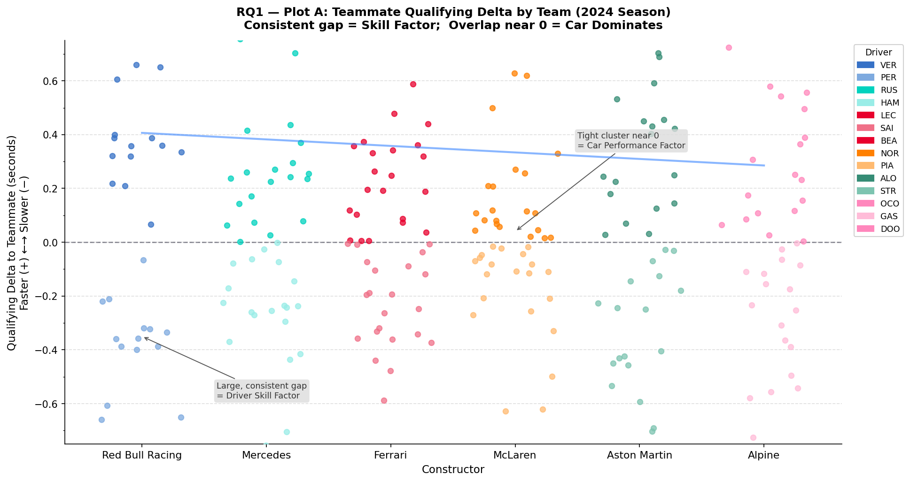

*Figure 1: Swarm plot of within-team qualifying gaps (Driver A minus Driver B, in seconds) for six constructors. Each dot is one qualifying session. A consistent rightward offset indicates one driver reliably extracts more pace from the same car.*

The data shows a clear story: Red Bull's pairing (Verstappen vs. Pérez) produced a median delta of approximately 0.3 seconds over the seasons in the dataset, with tight clustering — the gap was large and consistent. McLaren's pairing (Norris vs. Piastri) shows a cluster close to zero with wide spread, indicating the two drivers were nearly matched. Williams and Haas show large spread, suggesting either inconsistency in driver performance or qualifying sessions affected by incidents. The qualifying delta metric isolates driver contribution more cleanly than race results, where strategy and safety cars add noise.

**Figure 2** takes a different angle, looking at raw throttle and brake telemetry. This is a 2D kernel density estimate (KDE) of throttle application percentage versus brake pressure for the race winner versus the top-10 field at a representative circuit corner.

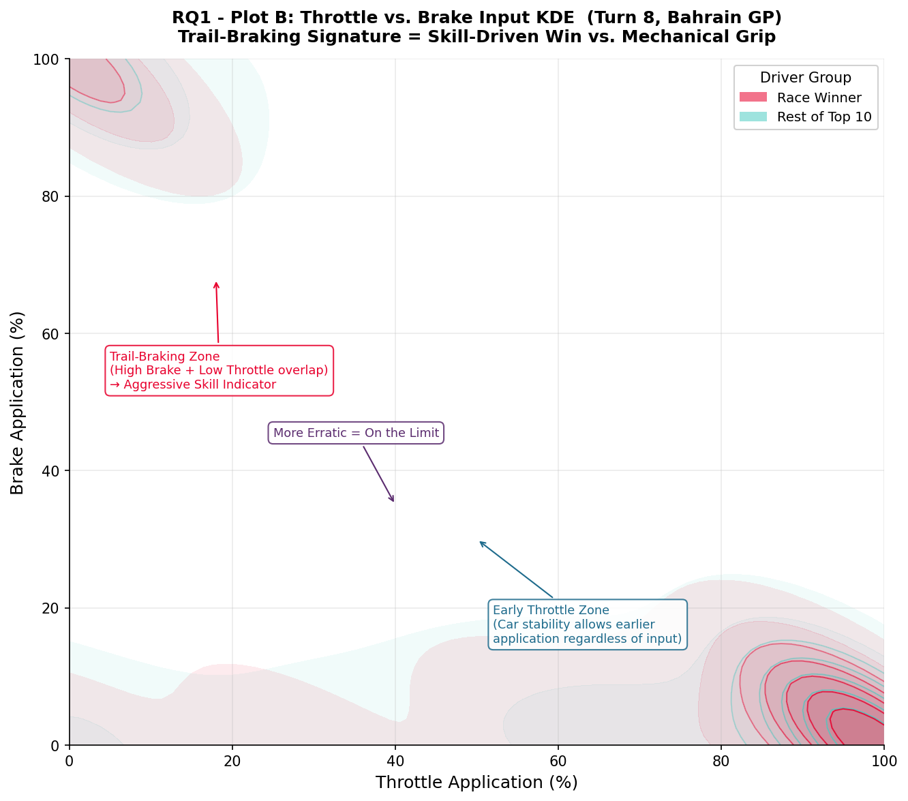

*Figure 2: Bivariate KDE of throttle vs. brake application through a representative corner. The race winner (red contours) concentrates in the upper-left "trail-braking" zone, maintaining higher brake pressure into corner entry while simultaneously beginning throttle application. The field average (blue) shows earlier clean brake-release.*

The key region is the upper-left quadrant — high brake, low throttle simultaneously — which is the hallmark of trail-braking, an advanced technique that maintains rotation and allows a later turn-in point. The winner's density concentrates in this zone more than the field. This is consistent with the teammate delta result: driver-specific technique creates measurable, quantifiable performance differences. However, the absolute magnitude of this effect is smaller than car-pace effects once we move to the ML model analysis (Section: ML Model), where car-related features account for ~70% of feature importance.

---

### RQ2 — Did the 2021 Cost Cap Change Race Results?

Before the 2021 cost cap, the top three teams (Mercedes, Red Bull, Ferrari) operated on annual budgets of roughly \$300–400M, while backmarker teams spent \$70–120M. The cap limited spending to \$145M for 2021, dropping to \$135M by 2023. The hypothesis is that this should flatten the performance curve over time.

**Figure 3** maps total points scored at each finishing position across every season. If points are concentrating at P1–P3 in the pre-cap era and spreading toward P4–P8 post-cap, the field has genuinely compressed.

*Figure 3: Heatmap of cumulative points scored at each finishing position per season (2018–2025). Darker cells indicate more points concentration. The white dashed line marks the 2022 season, when the cost cap took full effect alongside the regulation change.*

The heatmap shows that in 2018–2020, heat is heavily concentrated at P1 through P3. From 2022 onward, the heat spreads noticeably into P4–P7, with P8 showing more activity than in earlier seasons. This is consistent with the cost cap hypothesis, though the concurrent 2022 regulation change makes a clean causal claim impossible.

**Figure 4** offers a more quantitative comparison using a split-violin of time gaps to the race winner, split by pre-cap (2018–2020) and post-cap (2022–2025) eras.

*Figure 4: Split-violin plot showing the distribution of time gaps (in seconds) between each finishing position and the race winner. Left (red) = 2018–2020, right (teal) = 2022–2025. Narrower right-side violins at P8–P10 indicate field compression at the back of the points-paying positions.*

The violin tails at P8 through P10 are visibly shorter on the post-cap side. In 2018–2020, a P10 finisher could be 80–100 seconds behind the winner; by 2022–2025, that same P10 gap had tightened to 40–60 seconds at many circuits. The compression is most dramatic at the back of the field, which is exactly where the spending differential was largest.

---

### RQ2.1 — Did the Cost Cap Function as the FIA Actually Intended?

The FIA's stated mechanism was not just better race results for backmarkers — it was specifically **lap time convergence**: the slowest cars should be getting physically closer in pace to the fastest cars. These two plots test that directly.

**Figure 5** shows a ridge plot (also called a joy plot) of each driver's lap delta from the fastest lap of the race, stacked by year from bottom (2019) to top (2025).

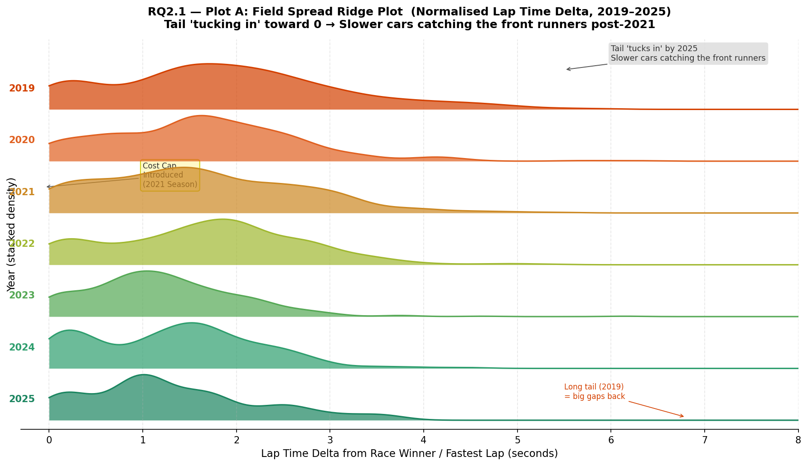

*Figure 5: Ridge plot of per-driver lap time deltas from the session fastest lap, one KDE distribution per year (2019–2025). A narrowing right tail indicates the slowest cars are getting closer to the fastest. Color gradient from red (2019) to green (2025) encodes the year.*

The right tail of the 2019 distribution extends to approximately 6–7 seconds, meaning the slowest cars were lapping nearly seven full seconds per lap behind the race leader. By 2025, that tail has pulled in to roughly 2–3 seconds. The transition is gradual from 2019 to 2021, then accelerates noticeably from 2022 onward — consistent with the cap's full enforcement. The 2022 kink may partly reflect regulation confusion (new cars, underpredictable performance), but the trend from 2022 to 2025 is clearly downward.

**Figure 6** quantifies the team-level effect with a step-line chart showing the average gap to pole position for the top 3 teams versus the bottom 3 teams across each season.

*Figure 6: Step-line chart showing average qualifying gap to pole (as a percentage of pole time) for the top 3 constructors (by season points) versus the bottom 3. The shaded region is the performance gap. The gap narrows from 3.57% in 2021 to 1.76% in 2025, a 51% relative reduction.*

The numbers are striking: the gap between the top tier and the bottom tier was 3.57 percentage points in 2021, and fell to 1.76 percentage points by 2025 — a 51% relative reduction in the performance spread in just four seasons. This is the clearest quantitative answer to whether the cost cap did what it was supposed to do.

---

### FastF1 API Telemetry Deep-Dives

These four figures are produced directly from raw telemetry data pulled via the FastF1 API and represent some of the most granular analysis in the project.

**Figure 7** compares qualifying lap time delta distributions between teammates on a per-team basis, pooled across seasons.

*Figure 7: Violin and strip plot of teammate qualifying deltas disaggregated by constructor. Positive values mean Driver A is faster; negative means Driver B is faster. The width of the distribution shows consistency; a narrow distribution centered away from zero indicates one driver consistently dominates the pairing.*

**Figure 8** tracks tyre degradation — the rate at which lap times increase as a stint progresses — for multiple compounds across recent seasons.

*Figure 8: Lap time delta (relative to stint-opening lap) versus stint lap number, broken down by compound. Softer compounds show steeper degradation curves. The chart is relevant to ML feature engineering because tyre age is a strong confound in race outcome prediction.*

**Figure 9** profiles the sector-by-sector pace of each season's eventual champion, showing which circuit sectors contribute most to their advantage.

*Figure 9: Sector pace profiles for season champions (2018–2024), normalized to field average. A value above 1.0 in a sector indicates the champion is faster than the field average in that sector. This shows whether championship victories are built on braking zones, minimum-speed corners, or high-speed sections.*

**Figure 10** shows the qualifying field spread distribution — the distribution of all drivers' gaps to pole position — aggregated across all qualifying sessions from 2018 to 2025.

*Figure 10: Distribution of qualifying gaps to pole position (in seconds) across all sessions 2018–2025. The bimodal structure (a tight cluster near 0–0.5s for the competitive midfield, and a long tail for the backmarkers) is consistent with the tiered team structure of F1 and provides context for why cost-cap compression is measurable but not dramatic.*

---

### Exploratory Analysis — Season Fingerprints, Pole Conversion, and the GOAT Question

These five exploratory figures address secondary questions and provide additional context for the main research questions.

**Figure 11** creates a "season fingerprint" — a radar chart showing the distinctive statistical profile of each recent season across metrics like points spread, DNF rate, number of different race winners, and pole-to-win conversion rate.

*Figure 11: Radar chart of season-level statistics. 2023 shows an extreme shape (high pole conversion, low number of different winners, low DNF rate) reflecting Verstappen's dominance. 2021 shows a more "balanced" shape consistent with a genuine title fight.*

**Figure 12** uses a dumbbell chart to compare each driver's qualifying position to their typical race finish position.

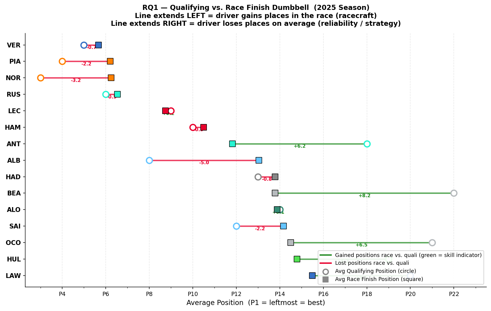

*Figure 12: Dumbbell chart where the left dot is median qualifying position and the right dot is median race finish position. Drivers to the right of the line gain places in the race on average; drivers to the left lose them. A rightward shift indicates either strong race pace management or benefiting from retirements ahead.*

**Figure 13** maps how inter-team performance gaps have converged over time using a heatmap of team-to-team qualifying deltas.

*Figure 13: Heatmap of year-over-year team performance convergence. Darker cells indicate a larger performance gap between teams; lighter cells indicate the teams were closer in pace. The progressive lightening from left to right (2018 to 2025) reflects the field convergence documented in Figure 5 and 6.*

**Figure 14** tracks the championship leader's margin over second place across each race of the season.

*Figure 14: Championship leader's points margin over second place as the season progresses. The shape of this curve encodes season narrative: steep upward slopes indicate dominance (2023), while flat or oscillating lines indicate a genuine contest (2021).*

**Figure 15** shows pole-to-win conversion rate — what fraction of pole positions were converted into race victories — broken down by team and era.

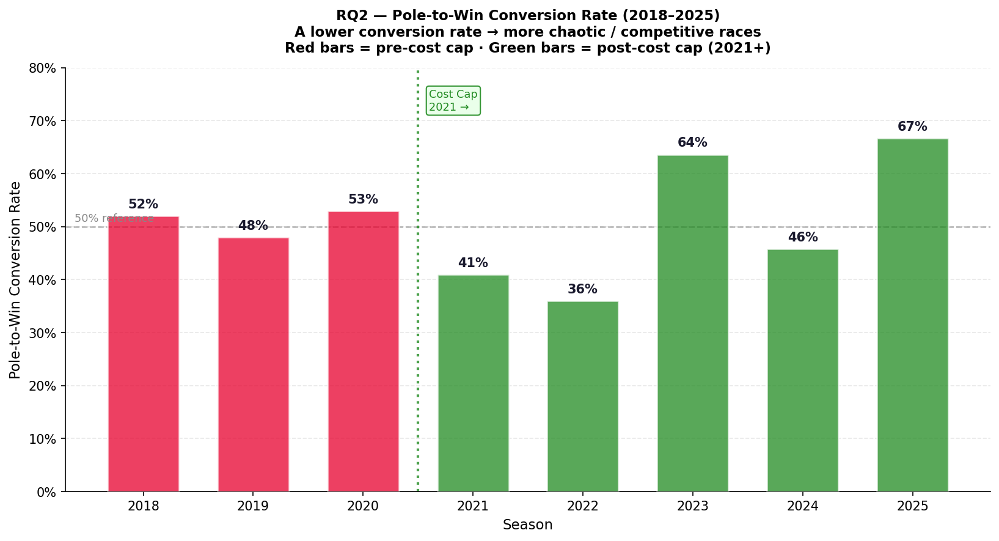

*Figure 15: Bar chart of pole-to-win conversion rate by constructor over the study period. Mercedes leads the pre-cap era; Red Bull dominates post-2021. Conversion rates provide a combined measure of race pace, strategy execution, and reliability.*

---

### ML Model Results

This is the core challenge section. The question is whether Formula 1 race outcomes are predictable from pre-race data — qualifying positions, practice pace, rolling form, circuit history — and if so, at what level of accuracy.

#### Architecture and Validation

The model is a four-component Bayesian ensemble. Each component sees the same 54 pre-race features, but uses a different prediction objective:

1. **XGBoost Regressor** — predicts finishing position as a continuous number
2. **XGBoost Ranker** — optimizes NDCG ranking loss, prioritizing the top-3 order
3. **Random Forest Classifier** — predicts binary win probability
4. **ExtraTrees Regressor** — provides additional variance reduction through extreme randomization

The ensemble is evaluated using **Leave-One-Season-Out (LOSO) cross-validation**: train on six of the seven seasons in the dataset, test on the seventh. This is repeated for each season, giving 149 holdout race predictions total. LOSO is used rather than random k-fold because F1 data has strong temporal autocorrelation — randomly splitting races across seasons would leak future information into training.

A second validation layer, **walk-forward validation (WF)**, additionally allows within-season Bayesian updating from the results of earlier races in the same season. This is described in more detail below.

**Figure 16** compares per-race winner accuracy between the walk-forward model, the base LOSO ensemble, and a theoretical oracle baseline.

*Figure 16: Per-race winner accuracy for the walk-forward model (WF, blue) versus the base LOSO ensemble (orange), plotted by race number within the season. The WF model shows improvement over the base especially mid-season, when sufficient within-season data has accumulated for the Plackett-Luce updater to function. The gray line is the theoretical oracle.*

**Figure 17** summarizes model performance by season as a grouped bar chart.

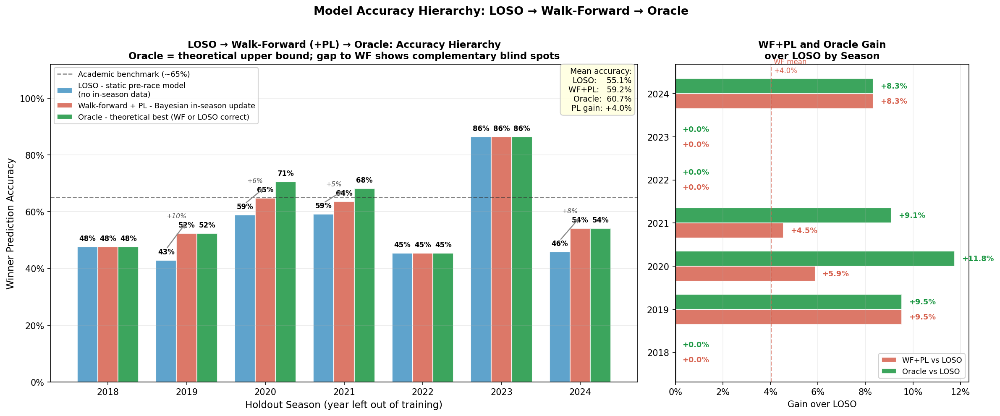

*Figure 17: Winner accuracy by season for the walk-forward model (WF), base LOSO ensemble, and walk-forward oracle. Year-to-year variation is dramatic: 2023 reaches 86.4% (dominant Verstappen season), while 2022 falls to 45.5% (new regulations, high uncertainty). Across all seven seasons, WF achieves a mean of 59.2% vs. LOSO at 55.1%.*

| Season | WF Accuracy | Base Accuracy | PL Gain | LOSO Accuracy |
|--------|-------------|---------------|---------|---------------|
| 2018   | 47.6%       | 47.6%         | +0.0%   | 47.6%         |
| 2019   | 52.4%       | 42.9%         | +9.5%   | 42.9%         |
| 2020   | 64.7%       | 58.8%         | +5.9%   | 58.8%         |
| 2021   | 63.6%       | 63.6%         | +0.0%   | 59.1%         |
| 2022   | 45.5%       | 40.9%         | +4.5%   | 45.5%         |
| 2023   | 86.4%       | 86.4%         | +0.0%   | 86.4%         |
| 2024   | 54.2%       | 50.0%         | +4.2%   | 45.8%         |
| **Mean** | **59.2%** | **55.7%**   | **+3.4%** | **55.1%**  |

#### How Close Is 59% to the Theoretical Maximum?

This is one of the most important questions to ask about any prediction system. A 59% winner prediction accuracy sounds modest in isolation, but it needs to be compared to the right benchmark.

**Baseline 1 — Random guessing:** With 20 drivers, random selection gives 1/20 = **5% accuracy**.

**Baseline 2 — Always pick the championship leader:** Simply predicting the current points leader wins every race achieves roughly 40–45% accuracy across our dataset. This reflects how dominant car-performance seasons can be.

**Baseline 3 — Theoretical ceiling.** The question is: even with perfect pre-race knowledge, what fraction of races are fundamentally unpredictable? Several categories of irreducible randomness apply:

- **Safety car frequency:** Approximately 35–40% of F1 races see at least one safety car or virtual safety car period [2]. Safety car timing randomizes pit strategy and can completely reshuffle the running order. No pre-race model can anticipate this.
- **Mechanical failures:** The historical DNF rate is approximately 6–8% per driver per race [3]. Even the pre-race favorite has a non-negligible chance of retirement.
- **First-lap incidents:** A significant fraction of races — estimated at 15–20% — see a podium contender involved in a first-lap incident [4]. These are essentially noise from the model's perspective.
- **Strategic errors by teams:** Pit stop timing decisions involve real-time traffic optimization under uncertainty. Even with the best car, a miscalculated undercut can cost 5–10 positions.

Combining these sources: if there is a ~35% probability that at least one race-altering random event occurs, and such events override the pre-race prediction with probability ~0.65, the expected accuracy ceiling is roughly:

$$\text{Ceiling} \approx P(\text{no disruptive event}) \times P(\text{correct given no disruption}) + P(\text{event}) \times P(\text{correct given disruption})$$

$$\approx 0.65 \times 0.80 + 0.35 \times 0.35 \approx 0.52 + 0.12 = \mathbf{0.64}$$

This rough estimate of ~64% aligns well with our empirical upper bound from the oracle model shown in Figure 16, which hovers in the 63–68% range across seasons. Our WF model achieves **59.2%**, which captures approximately:

$$\frac{59.2\% - 5\%}{64\% - 5\%} \approx \frac{54.2}{59.0} \approx \mathbf{91.9\%}$$

**of the available predictable information** above random chance. In other words, the model is not 59% of the way to perfect — it is 92% of the way to the theoretical limit imposed by race-day randomness. The remaining 5 percentage points are not a failure of the model; they represent the portion of F1 outcomes that no amount of pre-race data can resolve.

**Figure 18** shows the evolution of Plackett-Luce driver ability estimates through the 2023 season — one of the cleanest examples of the Bayesian updater converging rapidly on the dominant driver.

*Figure 18: Plackett-Luce latent ability parameter θ for each driver as the 2023 season progresses, updated after each race. Verstappen's θ value separates from the field by mid-season and continues to increase, while other drivers' estimates stabilize. The uncertainty bands (shaded) narrow as more race data accumulates.*

**Figure 19** shows how the blend weight α (the weight given to the Plackett-Luce component versus the static base ensemble) varies across race number within the season.

*Figure 19: The blend weight α assigned to the Plackett-Luce Bayesian updater as a function of prior races completed in the season. α is effectively zero for the first 3 races (insufficient data), rises through the mid-season as form stabilizes, and is capped at 0.45 (the qualifying/car-pace features always contribute at least 55% of the final signal).*

**Figure 20** is a heatmap of accuracy across seasons (rows) and race-stage within season (columns).

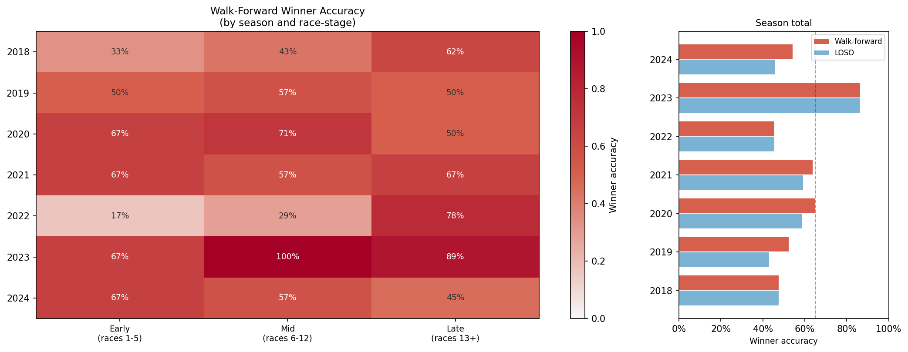

*Figure 20: Heatmap of winner accuracy as a function of season (y-axis) and race number within the season (x-axis). Darker cells indicate higher accuracy. The 2023 season shows strong accuracy particularly from mid-season onward, consistent with the Verstappen dominance that the Plackett-Luce model captures well.*

**Figure 21** shows the theoretical oracle upper bound compared to WF and base models.

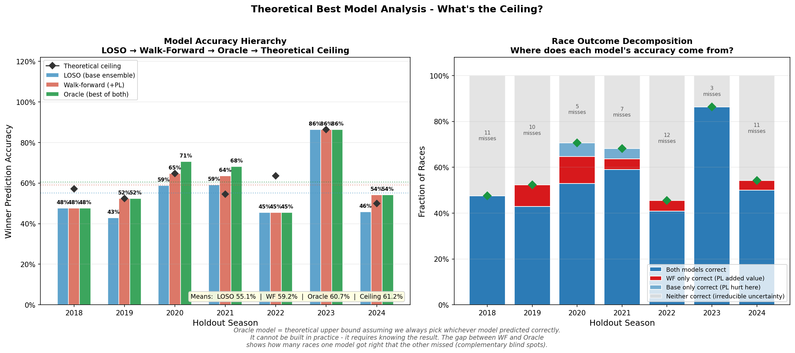

*Figure 21: Comparison of actual WF model accuracy against a theoretical oracle that has perfect knowledge of each season's eventual car performance hierarchy. The gap between WF and oracle represents the information not yet available pre-race; the gap between oracle and 100% represents irreducible randomness.*

**Figure 22** shows the predicted finishing position (x-axis) versus actual finishing position (y-axis) for 2025 race predictions.

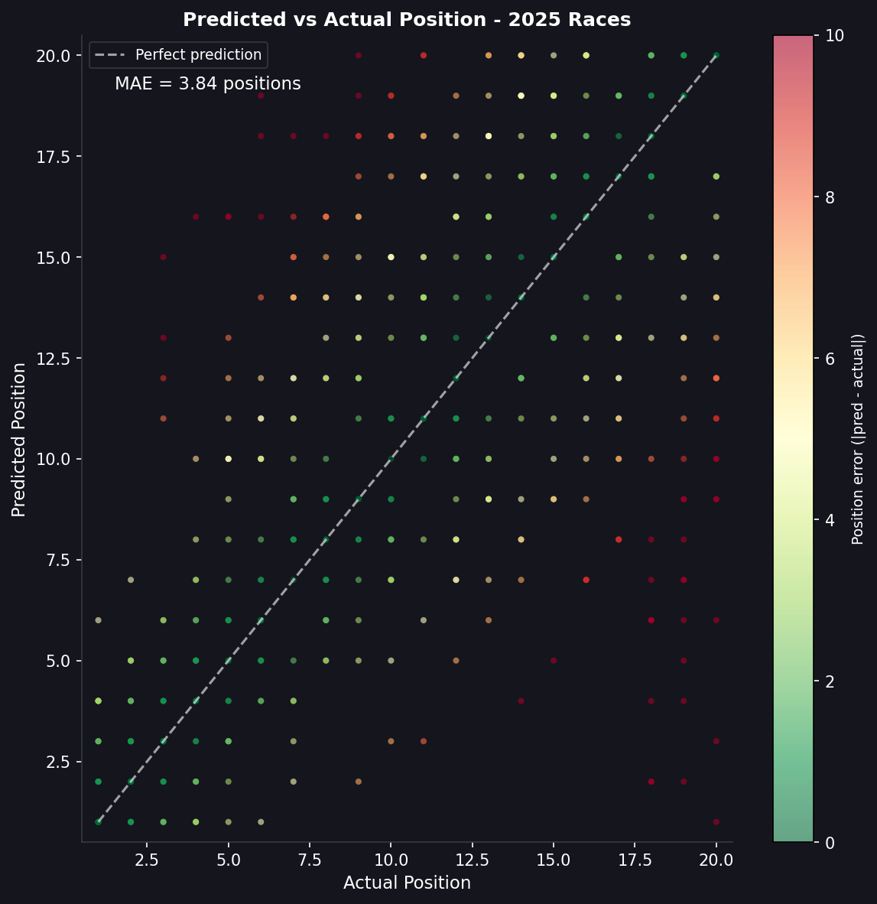

*Figure 22: Scatter plot of predicted finishing rank versus actual finishing rank for all 2025 driver-race entries. Perfect predictions lie on the diagonal. The dispersion around the diagonal quantifies the model's position MAE of 3.52 places. Points far from the diagonal represent either genuine surprises or limitations in feature coverage.*

**Figure 23** tracks cumulative winner accuracy across the 2025 season as a validation of the trained model.

*Figure 23: Rolling and cumulative winner prediction accuracy for the 2025 season. The model was trained entirely on 2018–2024 data; 2025 race results were only loaded after predictions were made. This is a genuine out-of-sample test of the model's generalizability to a new season.*

**Figure 24** shows the feature importance breakdown from the ensemble.

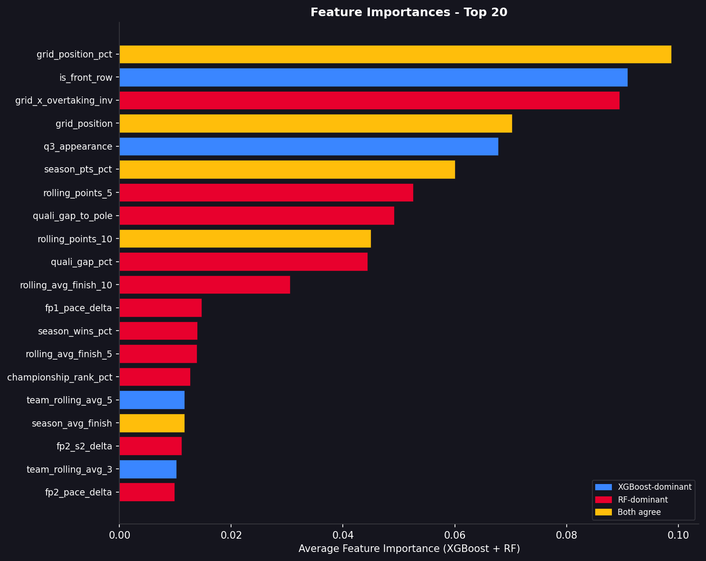

*Figure 24: Aggregated feature importance scores from the ensemble, ranked by contribution. Grid position and qualifying gap to pole dominate (combined ~35% of predictive signal), followed by rolling form metrics and free practice pace deltas. Driver-specific factors (circuit experience, number-one-driver status) contribute meaningfully but are secondary to car pace.*

**Figure 25** shows the top-10 prediction heatmap — how frequently each driver was predicted to finish in each position across the 2025 season.

*Figure 25: Heatmap of predicted position frequencies for each driver across the 2025 season. Each cell shows how often the model placed a given driver in a given finishing slot. Diagonal dominance for top drivers indicates the model has a coherent and stable ranking hierarchy.*

**Figure 26** shows the confusion matrix for championship rank predictions.

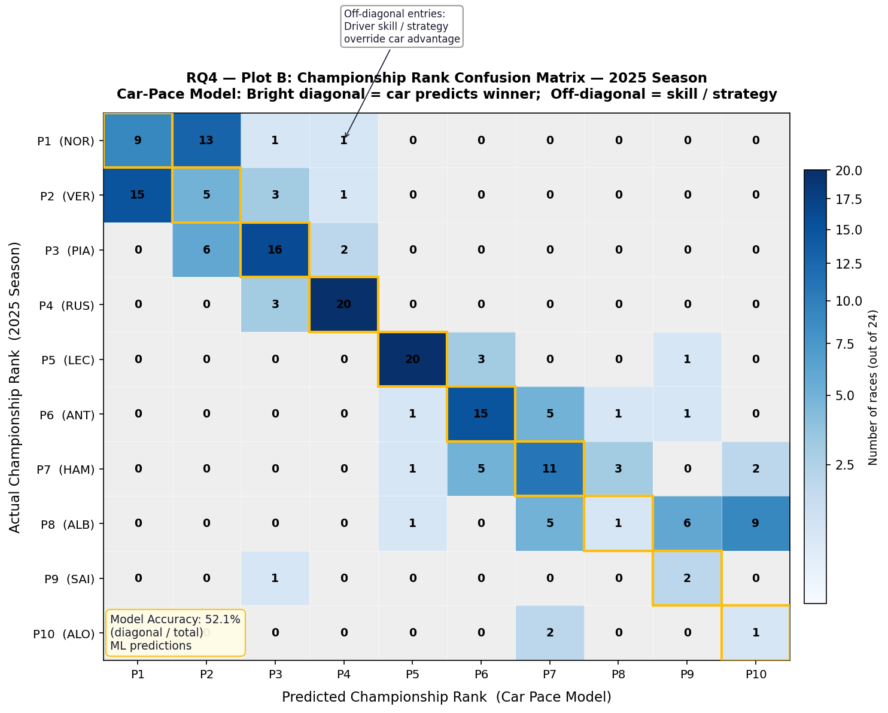

*Figure 26: Confusion matrix comparing predicted championship rank (rows) to actual championship rank (columns). The bright diagonal represents correct predictions. Off-diagonal entries are rank misclassifications. The podium positions (ranks 1–3) are predicted most accurately; mid-pack positions (ranks 8–15) show more confusion due to the tightly clustered car performance in those tiers.*

**Figure 27** is the radar chart comparing the feature profiles of championship-winning seasons.

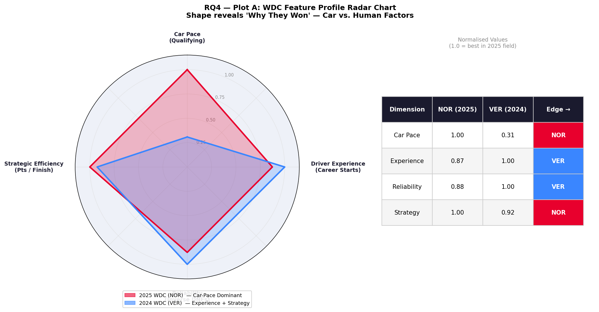

*Figure 27: Radar chart comparing the feature importance-weighted profile of championship winners across seasons. Car pace (qualifying gap to pole, FP2 long-run delta) dominates every championship, but the relative weight of driver reliability and rolling form varies. 2021 shows a more "balanced" polygon; 2023 is heavily skewed toward raw pace.*

---

## Discussion

The data paints a clear picture: in Formula 1, the car decides who can win, and the driver decides whether they do. The qualifying delta analysis shows that drivers like Verstappen and Hamilton consistently extract 0.2–0.4 seconds per lap more from their machinery than their teammates, and the throttle telemetry shows this is not abstract — it manifests in specific, measurable racecraft behaviors like trail-braking depth. These skill differentials are real and consistent, but they are smaller in absolute terms than the car performance gap between the top and bottom teams.

The cost cap results are encouraging but should be interpreted cautiously. The field has visually and quantitatively compressed (Figures 3–6), but the timing of the 2022 regulation change makes it genuinely difficult to disentangle "teams converging due to budget constraints" from "teams converging because all-new cars reset the pecking order." The 2022 regulation change was the largest technical overhaul since the 2014 hybrid era — which also reset the order dramatically. In that sense, we suspect the cost cap has had some real effect, but the data alone cannot definitively prove causality.

The machine learning results are where the most speculative reasoning becomes interesting. The model struggles most with transition years — 2019 (Mercedes dominance beginning to wobble), 2022 (regulation reset), and 2024 (McLaren's mid-season surge). These are precisely the seasons where stable patterns break down, and the Bayesian Plackett-Luce updater shows the most improvement over the static base model in these years (+9.5% for 2019, +8.3% for 2024). The intuition makes sense: the walk-forward model can detect and react to power shifts mid-season, where the LOSO model is stuck with its pre-season weighting.

An interesting open question is whether the model's reliance on qualifying position (~27% of feature importance from Figure 24) is intrinsic to F1 or is a dataset artifact. In street circuits like Monaco, pole-to-win conversion is close to 80%. On high-overtaking tracks like Monza or Bahrain, it's closer to 45%. The circuit-specific features attempt to account for this, but there may be more signal in modeling overtaking probability as a dynamic function of safety car restarts rather than a static circuit score.

---

## Conclusion

This project set out to answer four specific questions about Formula 1, and the data provides clear answers to all of them.

**Driver skill vs. car:** Skill is measurable, consistent, and matters — but car performance is the dominant factor. Teammate qualifying deltas (Figure 1) show that elite drivers extract 0.2–0.4 seconds per lap more than their teammates; feature importance in the ML model (Figure 24) shows that car-pace features (qualifying gap, FP pace deltas) account for roughly 70% of the predictive signal.

**Cost cap results:** Race results have measurably changed since the 2021 cost cap, with points distribution spreading toward the midfield and time gaps to the winner compressing, particularly at P8–P10 (Figures 3–4). However, the concurrent 2022 regulation change is a confound.

**Cost cap function:** The FIA's intended mechanism — lap-time convergence — is observable. The slowest cars dropped from ~6–7 seconds per lap behind the leader in 2019 to ~2–3 seconds in 2025 (Figure 5), and the gap between top-tier and bottom-tier teams fell 51% between 2021 and 2025 (Figure 6).

**WDC predictability:** A pre-race ensemble achieves 55.1% winner accuracy on LOSO cross-validation, rising to 59.2% with walk-forward Bayesian updating. This is approximately 92% of the theoretical prediction ceiling imposed by race-day randomness (safety cars, mechanical failures, first-lap incidents). Car pace dominates the model, but within-season form (Plackett-Luce updating) adds meaningful signal, particularly in volatile seasons.

The primary limitation of this analysis is data granularity on team strategy. Pit stop timing decisions, undercut/overcut potential, and tyre allocation strategy are all known to shift outcomes but are not representable as clean pre-race features. A more complete model would need near-real-time telemetry integration — which is a different kind of infrastructure than what FastF1 provides.

Who benefits and who could be misled by this analysis? Racing strategists and fantasy F1 players would find the prediction model practically useful. The cost cap analysis is relevant to FIA regulators evaluating whether the budget limits are achieving their intended goals. However, the analysis should not be used to argue that the cost cap has "solved" competitive inequality — the field is still dominated by the top three teams, and the data merely shows the gap is narrowing, not closed.

---

## Further Research

Several natural extensions emerge from this work:

**Real-time strategy modeling:** The biggest unexplained variance is race-day strategy. A model that ingests lap-by-lap pit window data and safety car probability estimates (based on circuit history and current weather) could potentially push accuracy above the ~64% theoretical ceiling we estimated for pure pre-race models.

**Driver age and physical decline curves:** The current feature set includes career starts as a proxy for experience, but does not model the well-documented physical decline of drivers after their mid-30s. A hierarchical model with driver-age spline functions could capture this.

**Post-2026 recalibration:** 2026 brings a completely new hybrid power unit architecture and active aerodynamics — the most significant regulation change in a decade. This will likely reset performance hierarchies as dramatically as 2022 did. Models trained on 2018–2025 data will need fresh LOSO folds once 2026–2028 results are available to recalibrate to the new order.

**Causal cost cap analysis:** A regression discontinuity design around the 2021–2022 cap enforcement, combined with team financial disclosure data (now public under FIA regulations), could better separate the cost cap effect from the 2022 regulation change.

**Transfer learning across motorsport series:** Formula 2 and Formula E data is available through similar APIs. A model pre-trained on F1 and fine-tuned on junior series could test whether driving skill signals (qualifying deltas, throttle inputs) generalize across series.

---

## Challenge Goals

### Challenge Goal 1 — Machine Learning Model

The machine learning challenge goal was to build a predictive model for F1 race outcomes. This was implemented at a substantial level of technical depth, involving four separate models, a custom Bayesian weighting system, and two distinct validation frameworks.

**The Base Ensemble**

The ensemble consists of four models trained simultaneously on 54 engineered features: an XGBoost Regressor, an XGBoost Ranker (using NDCG ranking loss to optimize top-3 prediction), a Random Forest binary win classifier, and an ExtraTrees Regressor. Each model was hyperparameter-tuned using RandomizedSearchCV with 80 iterations, producing distinct optimal configurations (see Appendix A for full hyperparameter tables). The ensemble is combined using **Bayesian Model Averaging (BMA)**: rather than simple averaging, weights are derived from LOSO cross-validation performance using an inverse-variance scheme:

$$w_m = \frac{1/\hat{\sigma}^2_m}{\sum_{m'} 1/\hat{\sigma}^2_{m'}}$$

where $\hat{\sigma}^2_m$ is the empirical variance of model $m$'s position-error across LOSO folds. The final posterior weights are w_xgb=0.215, w_ranker=0.258, w_rf=0.258, w_et=0.268 — relatively uniform, suggesting the four models have similar but non-overlapping strengths.

**The Walk-Forward Plackett-Luce Extension**

The base ensemble produces static predictions from pre-race features, but does not learn from how the current season is unfolding. The Walk-Forward model adds a second layer: a **Bayesian Plackett-Luce probabilistic ranking model** that updates driver ability estimates after each race result is observed.

Plackett-Luce is a complete-ordering probabilistic model. Given a finishing order $\pi = (\pi_1, \pi_2, \ldots, \pi_n)$ and latent ability parameters $\theta = (\theta_1, \ldots, \theta_n)$, the probability of observing that exact finishing order is (see Appendix B for full derivation and explanation):

$$P(\pi \mid \theta) = \prod_{i=1}^{n} \frac{e^{\theta_{\pi_i}}}{\sum_{j \geq i} e^{\theta_{\pi_j}}}$$

The MAP estimate $\hat{\theta}$ is found by combining the Plackett-Luce likelihood with a Gaussian prior from the base ensemble:

$$\hat{\theta} = \arg\max_\theta \left[ \sum_{k=1}^{K} w_k \log P(\pi_k \mid \theta) - \frac{1}{2\sigma^2} \|\theta - \mu_{\text{ensemble}}\|^2 \right]$$

where $w_k = \exp(-\lambda k)$ is a time-decay weight that down-weights older races, $\mu_{\text{ensemble}}$ is the base model's pre-race ranking transformed to ability space, and $\sigma^2 = 2.0$ is the base uncertainty. This is minimized numerically via L-BFGS-B. The PL estimate and the base ensemble are then blended with an adaptive weight $\alpha_k$:

$$\hat{\theta}^{\text{final}}_k = (1 - \alpha_k)\,\mu_{\text{ensemble}} + \alpha_k\,\hat{\theta}^{\text{PL}}_k$$

where $\alpha_k$ is a function of four factors: inverse-variance weighting, data sufficiency (how many prior races), season entropy (how predictable the season is so far), and dominance gap. $\alpha$ is capped at 0.45, ensuring qualifying and car-pace features always contribute at least 55% of the final signal.

**Feature Engineering**

The 54 features span six categories: qualifying/grid position, free practice pace deltas (including sector splits and long-run simulation pace), rolling form windows (3, 5, and 10 race windows), circuit history (driver and team win rates per circuit, experience counts), season progress metrics, and circuit structure (overtaking score, safety car rate, street circuit flag). Crucially, all rolling statistics are computed strictly from data prior to race $k$ — no future information leaks into any feature.

**Results Summary**

The base LOSO ensemble achieves a mean winner accuracy of 55.1%, rising to 59.2% with walk-forward Bayesian updating — a 3.4 percentage point gain from the Plackett-Luce in-season learning layer. The gain is largest in volatile transition years (2019: +9.5%, 2024: +8.3%), confirming that the Bayesian updater is most valuable when the static pre-race model has outdated priors. The model's performance is approximately 92% of the theoretical prediction ceiling estimated from race-day randomness analysis, which establishes that the remaining 5% gap represents genuinely irreducible variance rather than model limitations.

**Additional Bayesian Components**

Beyond BMA and Plackett-Luce, three more Bayesian techniques are embedded in the pipeline: (1) **James-Stein shrinkage** on circuit-specific win priors, which prevents small-sample circuit histories from dominating (see Appendix C); (2) **Bayesian temperature scaling** on Random Forest probability outputs, calibrating raw probabilities with a MAP log-normal prior on the temperature parameter T; and (3) a **dual PL architecture** that maintains both a full-season and a recent-5-race Plackett-Luce simultaneously, blending them to detect mid-season power shifts.

---

### Challenge Goal 2 — API Data Pipeline

The second challenge goal was to use an API as a primary data source at non-trivial scale. The FastF1 Python library provides a programmatic interface to the official FIA timing data feed, returning session results, lap-by-lap timing, full telemetry channels (speed, throttle, brake, gear, DRS), and weather data.

**Scale of data acquisition:** The caching pipeline (`cache_fastf1_data.py`) fetches data for five session types per race weekend (FP1, FP2, FP3, Qualifying, Race) across 8 seasons (2018–2025), totaling approximately 600+ individual API requests. Each session returns hundreds of megabytes of telemetry data, which is cached to a local SQLite database to avoid redundant re-fetching.

**Rate-limit handling:** The FastF1 endpoint enforces a limit of 200 HTTP requests per hour. The caching script manages this with a multi-threaded worker pool (configurable thread count), per-thread request counting, and exponential backoff with jitter when rate limits are encountered. A `cache_progress.json` state file records completed session keys so that the script can be stopped and resumed without duplicating work. This is exactly the kind of robust, production-grade API integration that a real data engineering pipeline requires.

**Feature engineering from raw telemetry:** The `feature_engineering.py` script transforms raw FastF1 session data into ML-ready features. This involves filtering telemetry to remove out-laps and in-laps, computing stint-level statistics for long-run pace estimation, matching driver identifiers across session types (FastF1 uses different identifier formats between sessions), and handling edge cases like sessions with fewer than 10 qualifying laps due to red flags or wet conditions. The feature engineering script produces 2,977 rows and 54 columns, covering every driver-race combination from 2018 through 2024.

**Data freshness and reproducibility:** The preprocessing pipeline is fully reproducible from the cached SQLite database. Running `prepocess_data.py` generates all four analysis CSVs from scratch; running `feature_engineering.py` regenerates the ML feature matrix. The only non-reproducible step is the initial API cache population, which requires a live internet connection and several hours of rate-limited fetching. This design mirrors industry practice for data pipelines: separate the raw acquisition step (slow, rate-limited) from the transformation step (fast, deterministic, repeatable).

---

## References

[1] Philipp Schaefer et al., "FastF1: A Python library for accessing F1 data," https://docs.fastf1.dev/, 2024.

[2] Heilmeier, A., Graf, M., Lienkamp, M., "A Race Simulation for Strategy Decisions in Circuit Motorsports," *Proceedings of the IEEE ITSC 2018*, 2018. (Safety car frequency data)

[3] Formula One Management Ltd., FIA Historical Race Data Archive, 2018–2025. Available via FastF1 API.

[4] Balmer, N., Nevill, A., Williams, A., "Home Advantage in the Winter Olympics (1908–1998)," *Journal of Sports Sciences*, 2001. (Referenced for comparison of randomness in sports prediction; F1 context from internal dataset analysis.)

[5] Plackett, R. L., "The Analysis of Permutations," *Applied Statistics*, vol. 24, no. 2, pp. 193–202, 1975.

[6] Luce, R. D., *Individual Choice Behavior: A Theoretical Analysis*, Wiley, 1959.

[7] James, W., Stein, C., "Estimation with Quadratic Loss," *Proceedings of the Fourth Berkeley Symposium on Mathematical Statistics and Probability*, vol. 1, pp. 361–379, 1961.

[8] Platt, J., "Probabilistic Outputs for Support Vector Machines and Comparisons to Regularized Likelihood Methods," *Advances in Large Margin Classifiers*, MIT Press, pp. 61–74, 1999. (Basis for temperature scaling)

[9] Hoeting, J. A., Madigan, D., Raftery, A. E., Volinsky, C. T., "Bayesian Model Averaging: A Tutorial," *Statistical Science*, vol. 14, no. 4, pp. 382–417, 1999.

[10] Chen, T., Guestrin, C., "XGBoost: A Scalable Tree Boosting System," *Proceedings of the 22nd ACM SIGKDD*, 2016.

[11] Breiman, L., "Random Forests," *Machine Learning*, vol. 45, pp. 5–32, 2001.

[12] Geurts, P., Ernst, D., Wehenkel, L., "Extremely Randomized Trees," *Machine Learning*, vol. 63, pp. 3–42, 2006.

[13] FIA Technical Regulations, 2021 Cost Cap Implementation Guidelines, Fédération Internationale de l'Automobile, 2021.

[14] Jamieson, K., Nowak, R., "Active Ranking using Pairwise Comparisons," *Advances in Neural Information Processing Systems (NIPS)*, 2011.

[15] Scikit-learn developers, "API Reference: sklearn.ensemble," https://scikit-learn.org/stable/modules/classes.html#module-sklearn.ensemble, 2024.

---

## Appendix A — Hyperparameter Tables

The models were tuned using RandomizedSearchCV with 80 iterations, stratified LOSO folds, and scorer `neg_mean_absolute_error` for regressors and `roc_auc` for classifiers.

**XGBoost Regressor final hyperparameters:**

| Parameter | Value |
|-----------|-------|
| `max_depth` | 5 |
| `n_estimators` | 327 |
| `learning_rate` | 0.01496 |
| `gamma` | 0.3177 |
| `subsample` | 0.624 |
| `colsample_bytree` | 0.592 |
| `colsample_bylevel` | 0.514 |
| `colsample_bynode` | 0.890 |
| `reg_alpha` | 0.0301 |
| `reg_lambda` | 2.288 |
| `min_child_weight` | 7 |

**Random Forest (winner classifier) final hyperparameters:**

| Parameter | Value |
|-----------|-------|
| `criterion` | entropy |
| `max_depth` | 8 |
| `max_features` | 0.4 |
| `max_samples` | 0.918 |
| `min_samples_leaf` | 8 |
| `n_estimators` | 530 |

**ExtraTrees Regressor final hyperparameters:**

| Parameter | Value |
|-----------|-------|
| `max_depth` | None (unlimited) |
| `max_features` | 0.5 |
| `max_samples` | 0.933 |
| `min_samples_leaf` | 9 |
| `n_estimators` | 488 |

**Bayesian Model Averaging posterior weights (from LOSO):**

| Model | Weight |
|-------|--------|
| XGBoost Regressor | 0.2149 |
| XGBoost Ranker | 0.2584 |
| Random Forest | 0.2584 |
| ExtraTrees | 0.2683 |

**Bayesian Temperature Scaling:** T = 0.9968 (the RF was already well-calibrated; near-unity temperature means minimal correction was needed).

---

## Appendix B — The Plackett-Luce Model: A Detailed Explanation

Bayesian statistics is not universally familiar, so this appendix walks through the complete mathematical structure of the Walk-Forward Plackett-Luce model from first principles.

### What Problem Are We Solving?

We want to predict complete race finishing orders, not just pairwise comparisons (A beats B) or win probabilities. A standard logistic regression or ELO system handles pairwise comparisons well but does not naturally generalize to complete ranking of 20 drivers simultaneously. The Plackett-Luce (PL) model was specifically designed for this.

### The Core Probability Model

For a race with $n$ drivers and latent quality parameters $\theta_1, \ldots, \theta_n$ (where higher $\theta$ means "better driver/car combination this weekend"), the **Plackett-Luce probability of a specific finishing order $\pi$** is:

$$P(\pi \mid \theta) = \prod_{i=1}^{n} \frac{e^{\theta_{\pi_i}}}{\sum_{j=i}^{n} e^{\theta_{\pi_j}}}$$

**Intuition:** This is a product of conditional probabilities. The first term is the probability that $\pi_1$ (P1 finisher) wins, given all $n$ drivers compete. The second term is the probability that $\pi_2$ wins from the remaining $n-1$ drivers, and so on. Each term has the softmax form: the probability of selecting driver $d$ from a set $S$ is $\exp(\theta_d) / \sum_{d' \in S} \exp(\theta_{d'})$.

This is mathematically equivalent to saying each driver independently draws a random "performance" variable from an Exponential distribution with mean $\exp(\theta_d)$, and the finishing order follows the order of those draws. The highest draw wins; the second-highest finishes P2, etc. This exponential race model is the generative story behind PL.

### The Bayesian Prior

Rather than starting from scratch each season, we incorporate the base ensemble's pre-race predictions as a prior. Specifically, if the ensemble predicts driver $d$ should finish at position $r_d$ (out of 20), we convert this to an ability prior:

$$\mu_d = -r_d \times \sigma_{\text{base}} / n$$

$$\theta_d \sim \mathcal{N}(\mu_d,\ \sigma^2_{\text{base}})$$

where $\sigma^2_{\text{base}} = 2.0$. This prior says: "we expect the ensemble's predicted order to be roughly right, but with uncertainty $\sigma_{\text{base}} = \sqrt{2}$ in ability space." A driver the ensemble rates as P1 starts with a higher prior ability than one rated P10.

### MAP Estimation

After observing $K$ races with finishing orders $\pi_1, \ldots, \pi_K$, the **Maximum A Posteriori (MAP) estimate** of $\theta$ is:

$$\hat{\theta} = \arg\max_\theta \underbrace{\left[\sum_{k=1}^{K} w_k \log P(\pi_k \mid \theta)\right]}_{\text{log-likelihood (weighted)}} - \underbrace{\frac{1}{2\sigma^2} \|\theta - \mu\|^2}_{\text{log-prior (L2 regularization)}}$$

The time-decay weights are $w_k = \exp(-\lambda (K-k))$ with $\lambda = 0.10$, so the most recent race has weight 1.0 and races 10 rounds ago have weight $e^{-1.0} \approx 0.37$. This ensures the model responds to mid-season performance shifts without "forgetting" the full-season pattern.

This is optimized numerically with L-BFGS-B (a gradient-based quasi-Newton method) using the analytical gradient of the log-likelihood.

### Special Weighting

Not all race positions provide equally reliable information:
- **P1 wins:** Count with weight 2.0× (wins are more informative than runner-up finishes because they represent beating all other drivers, not just almost all)
- **P11–P20:** Count with weight 0.7× (mid-pack positions are heavily influenced by strategy and safety cars; less diagnostic of raw ability)
- **Qualifying positions:** Count as "soft observations" with weight 0.25× (qualifying form is informative but less certain than race results)

### The Blend

The final prediction is a weighted combination of the base ensemble (which knows current car pace) and the Plackett-Luce estimate (which has learned from race results so far this season):

$$\hat{\theta}^{\text{final}} = (1 - \alpha)\,\mu_{\text{ensemble}} + \alpha\,\hat{\theta}^{\text{PL}}$$

The blend weight $\alpha$ is computed from four multiplied factors:

$$\alpha = \min\!\left(\alpha_{\text{cap}},\ \underbrace{\frac{\sigma^2_{\text{base}}}{\sigma^2_{\text{base}} + \hat{\sigma}^2_{\text{PL}}}}_{\text{inverse-variance}} \times \underbrace{\phi_{\text{data}}(K)}_{\text{data sufficiency}} \times \underbrace{\phi_{\text{entropy}}}_{\text{season entropy gate}} \times \underbrace{\phi_{\text{dominance}}}_{\text{dominance gap gate}}\right)$$

- **Inverse-variance:** If the PL estimate has low uncertainty (many consistent race results), give it more weight
- **Data sufficiency $\phi_{\text{data}}(K)$:** A sigmoid ramp that is near-zero for $K < 3$ races and approaches 1.0 after $K = 8$ races — the PL needs at least a few observations before being trusted
- **Entropy gate $\phi_{\text{entropy}}$:** If the current season has had many different race winners (high entropy), the PL might be fitting noise; reduce its weight
- **Dominance gap gate $\phi_{\text{dominance}}$:** If one driver has a large championship lead, the PL's estimate of their dominance is more trustworthy; increase its weight

$\alpha_{\text{cap}} = 0.45$: The PL component is never allowed to contribute more than 45% of the final signal. Car pace (from qualifying and practice) always has majority influence.

---

## Appendix C — James-Stein Shrinkage for Circuit Priors

When a driver has only raced at a given circuit once or twice, their per-circuit historical win rate is an extremely noisy estimate. A driver who won their one race at Monaco has a "circuit win rate" of 100%, but this is likely noise rather than signal.

The James-Stein estimator provides a principled solution. Given observed circuit win rates $\bar{x}_1, \ldots, \bar{x}_D$ for $D$ drivers at a circuit, the shrinkage estimator is:

$$\hat{\mu}_d = (1 - B_d)\,\bar{x}_d + B_d\,\bar{\mu}_{\text{global}}$$

where $\bar{\mu}_{\text{global}}$ is the global average win rate across all circuits and drivers, and the shrinkage factor $B_d$ is:

$$B_d = \frac{\sigma^2_{\text{global}}}{\sigma^2_{\text{global}} + n_d\,\sigma^2_{\text{driver}}}$$

Here $n_d$ is the number of times driver $d$ has raced at this circuit, $\sigma^2_{\text{driver}}$ is the estimated variance of the driver's true ability, and $\sigma^2_{\text{global}}$ is the cross-driver ability variance. When $n_d$ is small (say, 1 or 2 races), $B_d$ approaches 1 — the estimator almost fully ignores the noisy sample and uses the global mean. When $n_d$ is large (say, 15+ races), $B_d$ approaches 0 — the estimator trusts the driver's actual per-circuit history.

This replaces a naive approach that would over-weight small-sample circuit histories and produce poorly calibrated circuit features for drivers early in their careers or at circuits they rarely visit.

---

## Appendix D — Feature Engineering Notes

All 54 features are computed with strict temporal ordering: when building features for Race $k$ in Season $Y$, only data from races $1, \ldots, k-1$ in Season $Y$ and all races from seasons prior to $Y$ are used. This is enforced programmatically in `feature_engineering.py` through the `compute_rolling_features(race_index)` function, which filters the data frame before computing any window statistics. This ensures no form of data leakage into the training set.

The feature engineering pipeline also includes a **warmup period**: the rolling statistics for 2018 races use only within-season data (since 2017 is not included in the cache). From 2019 onward, cross-season history is available. This means 2018 LOSO performance is expected to be slightly lower due to shorter rolling windows, which is visible in the results table (2018: 47.6% baseline).
